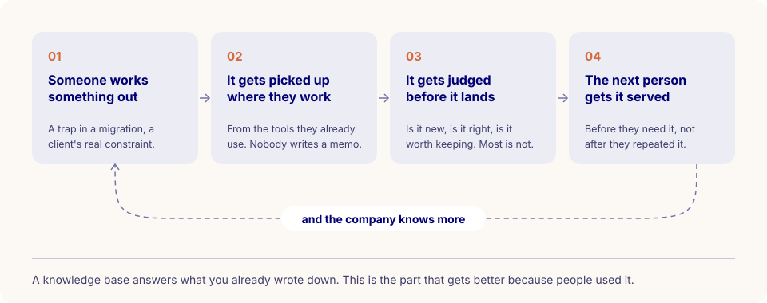
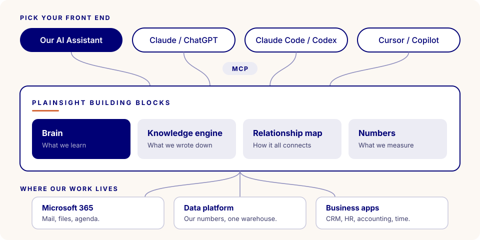
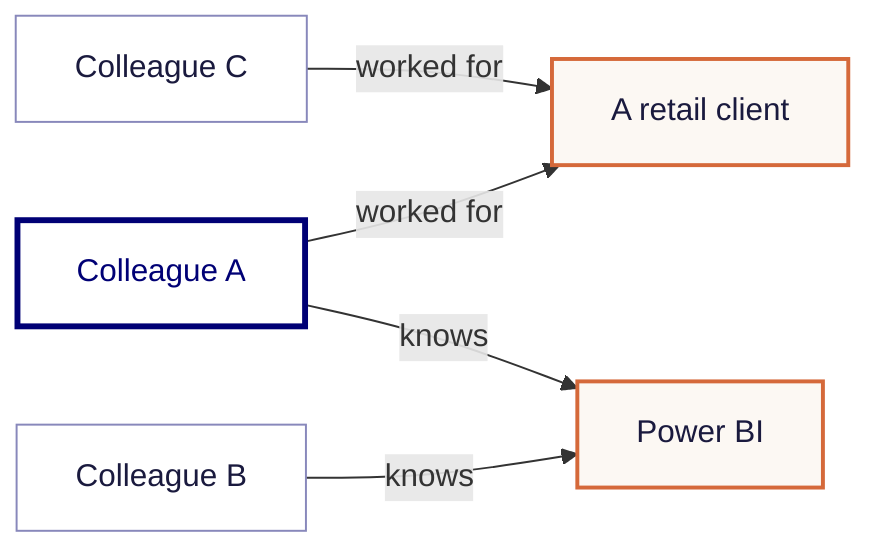
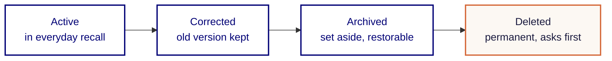

# AI-Native, In Plain Sight 🧠

> **Practise what you sell.**

Running a company comes with a lot of small, boring work: finding the right document, chasing a number, rebuilding last year's slide, asking who did that migration again. We hand that to AI and automation, so people spend their time on clients and on the work that needs a person.

Lean doesn't mean fewer people. It means fewer handoffs, fewer copy-pastes and fewer "can you send me that file".

## Innovative is nice. AI-native is the point.

Being innovative means you try new things. Being AI-native means the new thing is simply how the work gets done, on a Tuesday, on a client project, without anyone calling it a pilot.

| | AI-curious | AI-native |
|---|---|---|
| **Where AI lives** | A demo, a hackathon, a Friday afternoon | Inside the daily work and the back office |
| **What happens to a lesson** | Gone when the chat closes | Kept, ranked and handed to the next person |
| **Who picks the tool** | Someone in IT, once | You, every day |
| **What we tell clients** | What we read about | What we run ourselves |

That last row matters most. When we advise a client on agents, memory or governance, we want to be talking from the scars on our own hands, not from a slide.

## Meet the Plainsight Brain

Most of what a consultancy knows walks out the door at six in the evening. It sits in someone's head, in a chat window that is about to close, in a fix nobody wrote down. Three weeks later a colleague hits the same wall at a different client and spends an afternoon finding the same way around it.

The Brain is the colleague who sat in on every project, remembers what went wrong, and tells you before you do it again. Without the "well, actually".



You don't open a separate app or fill in a form. You tell your agent what you're about to do, the Brain briefs it, and when you're done the agent files what was worth keeping. Lessons that keep coming back get stronger. Lessons nobody uses quietly fade. A memory that keeps everything is a landfill, not a brain.

### What it knows

| What | Who sees it |
|---|---|
| **Your personal memory**: notes, decisions, gotchas from your own sessions | Only you |
| **Team lessons and warnings**: what colleagues learned and chose to share | Everyone at Plainsight |
| **This playbook**: synced from this repository every night | Everyone |
| **Engineering standards**: the guidelines that apply to the work in front of you | Everyone |
| **Company knowledge**: who worked where, who knows what, and our documents | Depends on your access rights |

Yes, that third row means the Brain has read this page. Ask your agent how to connect to the Brain and this is the answer it will give you. That is the whole idea.

## What we already do with it

A few examples. The list is open-ended on purpose.

- **Briefings before you start.** Your agent gets the project context and the lesson a colleague learned the hard way on another project, before you repeat it.
- **The brand kit.** Slides, one-pagers and web pages arrive on brand, because the agent pulled the complete brand kit first and the **brand check** read the result before anyone else did. It flags a filled-in triangle, the wrong font and dashes used as separators. You can guess who asked for that last one.
- **Audits with a second opinion.** Two AI models review the same work: one finds problems, the other challenges them. Every re-audit is compared with the previous one, so we see what got fixed and what keeps coming back. We audit the Brain this way too.
- **Handovers.** A project changes hands with everything the Brain knows about it, as a snapshot you preview before it's shared.
- **"Who should I talk to?"** gets answered with a name. Sometimes the most useful thing an extra brain can do is point at a human one.
- **Meeting prep.** What we've done in that sector, with which technology, and who worked on it.
- **Answers with a source.** Answers from our documents come with the paragraph they came from, and only from documents you're allowed to see.
- **Standards while you work.** The engineering guidelines that apply to your task show up during the work, instead of in a review afterwards.
- **Plans that survive.** Close the chat window and tomorrow's session picks up where today's stopped.
- **A private file library.** Reports, specs and other project files stay private until you decide who sees them.
- **Numbers in plain language.** Finance and sales questions, answered from the same figures as our Power BI reports.

Doing something by hand for the second time? That's how the next item gets on this list.

## How the Brain fits in

The Brain is one building block among several. Each does one job, they all speak the same open standard, and the first company they run on is Plainsight. If something doesn't survive our own consultants, with real deadlines and little patience for tools that need babysitting, it doesn't go to a client.



| Principle | In practice |
|---|---|
| **One job per block** | Memory, documents, relationships and numbers each live in their own piece. Any one of them can be replaced without rebuilding the rest. |
| **Open plugs** | Every block speaks MCP, an open standard. No private middleware, no lock-in to one AI vendor. |
| **Drafts, not decisions** | Agents prepare, people decide. Nothing goes to a client or to the team without a human yes. |
| **Your access travels with you** | Every block checks who you are. Nobody sees more through AI than they could see without it. |

### The relationship map: why we added a graph

Search is good at finding the page that answers your question. Some questions don't have a page.

"Which colleagues have retail experience and know Power BI?" The answer lives in two places: the project history says who worked for which client, the CVs say who knows what. No single document holds it, so no search engine can find it.

That's why the Brain has a relationship map behind it: a graph of people, clients, projects, skills and processes, and how they connect. Every connection carries the source it came from and a date.



Colleague A connects both halves of the question, so Colleague A is the answer, and both facts come along as evidence.

You never talk to the graph directly. When you ask the Brain something about the company, it asks the relationship map on your behalf, as you. The map only walks the connections you're allowed to see, finds what ties your question together, and returns the answer with its evidence path: which fact, from which source, from when. If the map is unavailable, the Brain says so and carries on with everything else.

### Why not just search our documents?

We already have a good document engine. It reads our files properly, cites the paragraph it answers from and respects who may see what. For "what did we promise in that proposal about support hours?" it's exactly the right tool: the answer is on a page, and it finds the page.

It works by finding the passages that look most like your question. That's also its limit, because some questions don't look like any passage.

| The question | What the document engine does | What the relationship map does |
|---|---|---|
| "What did we promise about support hours?" | Finds the paragraph and cites it. | Nothing. Not its job. |
| "Who has retail experience and knows Power BI?" | Finds CVs that mention Power BI and projects that mention retail, then leaves the joining to you. | Joins them. The colleague connected to both is the answer. |
| "Who should I talk to about this client?" | Returns documents about the client. | Returns people, through the projects they did for that client. |
| "Is Acme the same client as Acme Belgium NV?" | Sees two different names. | Knows it's one client, so nothing slips through the gap. |

So we didn't pick the graph instead of the documents. We put it on top. Documents answer *what we wrote down*. The map answers *how it all connects*. When you want proof, your agent goes back to the document engine for the actual paragraph, checked against your access again.

Keeping them as two separate blocks is deliberate too. The knowledge engine owns our documents and who may read them. The relationship map owns the connections, and it takes them from more than documents: the Brain, our numbers and our workflows can feed it as well. The map is never the source of truth. It points back to where each fact lives, so the original system keeps deciding who may see it.

Your own memories get a graph too. Only you can see that one: it's under [My Graph](https://barabas.plainsight.pro/my-brain/graph).

## Bring your own front end

We don't hand out one AI tool and call it a strategy. People do their best work in the tool they like, so the Brain comes to your tool instead of the other way round. Switch tools on Monday and your memory comes with you: it lives in the Brain, not in the tool.

There are two doors in:

- **Our AI Assistant.** The Brain is built in. Sign in with your Plainsight account and it's there. (Don't see it? Ask an AI Assistant admin.)
- **Any other AI tool, through MCP.** MCP, the Model Context Protocol, is an open standard for connecting tools and data to AI assistants. Think of it as a wall socket: we installed it once, and which kettle you plug in is up to you.

For the second door, everything starts from one address:

```text
https://barabas.plainsight.pro/mcp
```

You sign in with your `@plainsight.pro` account. There are no tokens to copy, no secrets to store and nothing to install on your laptop. The first time you connect, your tool opens a browser window, you log in, and that's it.

??? info "Claude Code"
    Run this once in your terminal and sign in when your browser opens:

    ```bash
    claude mcp add --transport http plainsight-brain https://barabas.plainsight.pro/mcp
    ```

    Type `/mcp` inside Claude Code to check that `plainsight-brain` shows as connected. For the deeper setup, see [Connect Plainsight Brain to Claude Code](../technical-guidelines/plainsight-ai/agentic-development/plainsight-brain.md).

??? info "Codex"
    Add this to `~/.codex/config.toml`. Codex opens a browser to sign you in.

    ```toml
    [mcp_servers.plainsight_brain]
    url = "https://barabas.plainsight.pro/mcp"
    ```

??? info "Cursor"
    Add this to `.cursor/mcp.json` in your project, or to your global Cursor MCP settings:

    ```json
    {
      "mcpServers": {
        "plainsight-brain": {
          "url": "https://barabas.plainsight.pro/mcp"
        }
      }
    }
    ```

??? info "GitHub Copilot in VS Code"
    Add this to `.vscode/mcp.json` in your workspace, then start the server from the MCP view in VS Code:

    ```json
    {
      "servers": {
        "plainsight-brain": {
          "type": "http",
          "url": "https://barabas.plainsight.pro/mcp"
        }
      }
    }
    ```

??? info "Anything else"
    Any tool that supports remote MCP servers over HTTP works the same way. Point it at `https://barabas.plainsight.pro/mcp` and complete the sign-in when the browser opens.

!!! tip "Check that it worked"
    Ask your agent: *"Run brain_start for the project I'm working on."* If it comes back with a project brief and a session id, you're in. If it says unauthorized, sign in again through your tool.

Working in Claude Code every day? [Connect Plainsight Brain to Claude Code](../technical-guidelines/plainsight-ai/agentic-development/plainsight-brain.md) goes deeper: user or project scope, the start-and-finish habit, making it stick in a repo, the tools you get, and troubleshooting.

## My Brain: see what it knows about you

A memory you can't see is a memory you can't trust. So everyone at Plainsight gets a window into their own Brain.

The Brain gets filled while you work, through your agent. [My Brain](https://barabas.plainsight.pro/my-brain) is where you look back: a web app that shows everything the Brain keeps for you, and lets you correct it. You don't need any special rights. Sign in with your Plainsight account and you see your own space, nobody else's.

| Area | What you'll find there |
|---|---|
| [**Overview**](https://barabas.plainsight.pro/my-brain) | Your space at a glance: memories, projects, recent sessions, and what stays private, in plain words. |
| [**Memories**](https://barabas.plainsight.pro/my-brain/memories) | Everything it remembers for you. Search by meaning, edit (the old version stays in the history), archive or delete. |
| [**Projects**](https://barabas.plainsight.pro/my-brain/projects) | The projects you worked on or that were shared with you, and who you've shared yours with. |
| [**Deliverables**](https://barabas.plainsight.pro/my-brain/deliverables) | A private library for reports, specs and PDFs. Shared with a project or the company only when you choose. |
| [**Sessions**](https://barabas.plainsight.pro/my-brain/sessions) | What your agent worked on, how long it took and how many prompts it needed. |
| [**Our Brain**](https://barabas.plainsight.pro/my-brain/our-brain) | The team side: the strongest lessons, plus one search across lessons, the playbook and our standards. Names are scrubbed, so who contributed stays private. |
| [**My Graph**](https://barabas.plainsight.pro/my-brain/graph) | Your own memories drawn as a graph of people, systems and decisions. Only you can see it. |

### Your first visit

Ten minutes, once, and you'll trust what your agent tells you a lot more.

| Try this | Why |
|---|---|
| Open **Memories** and search for a client or a technology you work with | You see what the Brain will tell your agent next time that topic comes up. |
| Fix anything that's wrong or outdated | Your agent will repeat it otherwise. The old version stays in the history. |
| Archive what no longer matters | It leaves your everyday view but stays yours, and you can bring it back. |
| Open **Sessions** | A work diary you didn't have to write. |
| Browse **Our Brain** | The lessons the team leans on most, and one search across lessons, the playbook and our standards. |

Nothing you do in My Brain loses anything by accident. From everyday to final, a memory is always in one of four states:



!!! info "Private by default"
    Your personal memory is yours. Nothing reaches the team unless you say yes. When your agent asks whether to share a lesson, that question is the point, not a formality.

## How to work with it

You don't need to learn the tools. Once connected, your agent knows to call them on its own. What helps is telling it what you're doing and letting it finish properly.

| Moment | What you say | What happens |
|---|---|---|
| **Starting** | "I'm fixing the incremental load in the Fabric pipeline for this client." | The Brain briefs your agent with project context, your past notes and the team's warnings for this kind of work. |
| **Wondering** | "Didn't we solve this somewhere before?" | The agent searches everything at once: team lessons, your memory, projects, the playbook, the relationship map. |
| **Finishing** | "Wrap up and save what we learned." | The agent files a short summary and the lesson worth keeping. |
| **Sharing** | "Yes, share it with the team." | The lesson joins the team memory and shows up for the next person who needs it. |

If a warning in your briefing actually saved you, let your agent say so. That signal tells the Brain the lesson was useful, which keeps it alive for the next colleague instead of letting it fade.

!!! warning "No finish, no memory"
    The work still happens if you skip the wrap-up. The team just doesn't learn anything from it. One sentence at the end is all it takes.

## Why this belongs in our playbook

None of this is a side project. It is our values with a database behind them.

| Our value | How we live it here |
|---|---|
| **🌐 Open Knowledge Ecosystem** | One person's lesson becomes everyone's head start. |
| **🗝️ Empowered Ownership** | You pick your tool. You decide what gets shared. |
| **🪟 Plain Sight** | You can see, correct and delete what the Brain knows about you, and every answer shows where it came from. |
| **♾️ 720° Feedback** | Lessons that help get confirmed and grow stronger. The rest fade. |

We are also the first end users of everything on this page, which makes the feedback loop short and occasionally very honest. That's exactly how we want to build AI for clients: with the people who will use it, from day one.

Read more about our values in [🥇 The Foundation of Plainsight](the-foundation-of-plainsight.md).

---

Something on this page out of date? You know the drill: you're one merge request away. And once it's merged, the Brain knows too.
