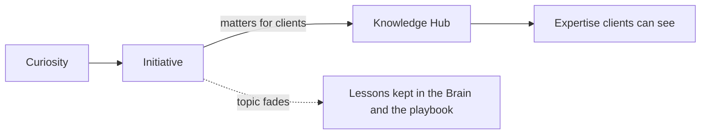

# Knowledge Hubs 📚

> **You can't show clients expertise you haven't built yourself.**

Clients rarely ask whether we know a technology. They ask who, exactly, and how deep. "A colleague on another project knows this really well" is an honest answer. It's also a weak one.

Earlier this year we started knowledge hubs: groups around a topic, led by whoever cared most about it. Today there are hubs on Databricks, Fabric, dbt and data modelling. They did what they promised. People shared what they learned, presented at evening sessions, wrote playbook pages and started building accelerators for client projects. They also ran on spare time, and spare time competes with client work. Client work tends to win that contest.

We've grown to a size where we can do more. So knowledge hubs get a real place in the organisation: a lead with a mandate, a plan with goals, and a certification path.

??? tip "TL;DR"
    Curiosity still needs nobody's approval: anyone can start an **initiative**. A **knowledge hub** is what an initiative becomes when we decide, as a company, that this is expertise we want to be known for. Hubs have a lead, a plan, topic experts and a certification path.

## Initiatives and hubs

Two levels, same spirit. Initiatives keep us curious. Hubs make sure the topics that matter most get serious, sustained attention.

| | Initiative | Knowledge Hub |
|---|---|---|
| **Starts when** | Someone wants to go deeper on a topic | A topic matters to our clients and to where Plainsight is heading |
| **Led by** | Whoever started it | A hub lead with a mandate to build the expertise |
| **Who joins** | Anyone, no strings attached | Anyone who signs up for the hub's goals, certification included |
| **Plan** | Not needed | Yes: goals, deliverables, who covers which area |
| **Lasts** | As long as the energy is there | As long as the topic matters to our clients |
| **Shows up in** | Evening sessions, playbook pages, lessons in the Brain | The same, plus presales conversations, events and, in time, our website |

An initiative that fades hasn't failed. If what it learned lives on in the [🧠 Plainsight Brain](ai-native.md) and the playbook, it did its job.

## What every hub has

| Part | What it means |
|---|---|
| **A hub lead** | One person who pulls. Not a manager: the lead keeps the plan moving, organises sessions and is the first name colleagues and offer leads hear for the topic. |
| **A plan** | What we want to reach and by when: goals, deliverables, certifications, and the profiles we still need to hire. One or two pages, not a binder. |
| **Topic experts** | Nobody has to know everything. The hub splits the technology into areas and makes sure each area has someone who goes deep. Together, the hub covers the whole platform. |
| **A certification path** | Joining a hub means working toward the certification that fits your area. |
| **Shared output** | Playbook pages, lessons in the Brain, internal sessions, blogs, accelerators, a talk at an event. If it stays in one head, it doesn't count. |

### Why certification

A certificate doesn't prove someone can build a platform. Experience does that. But clients ask for certificates, partners count them, and a certificate is often what gets you onto the project where the experience happens. So we treat certification as the entry ticket, not the finish line.

We'd rather set that goal together than hand out quotas. The company agrees on an ambition, every hub lead translates it to their technology, and we celebrate every certificate along the way.

<!-- Add the company-wide certification ambition here once it has been announced internally. -->

!!! info "Joining a hub doesn't put you in a box"
    Picking a hub is not picking a lane for life. If your next project runs on another platform, go. You can be part of two hubs, or of none. What a hub asks is that while you're in it, you take its goals seriously.

## Our hubs today

| Hub | What it works on | Start reading |
|---|---|---|
| **Databricks** | Deep expertise across the whole platform, from AI and Genie to ingestion and analytics | [Databricks best practices](../technical-guidelines/databricks/compute-selection.md) |
| **Fabric** | One shared way of building on Fabric: a framework we can deploy at clients instead of everyone bringing their own | [Fabric best practices](../technical-guidelines/fabric/workspace-organization.md) |
| **dbt** | Our dbt standards, and an accelerator that gives client projects a head start | [dbt best practices](../technical-guidelines/dbt/project-structure.md) |
| **Data modelling** | Solid dimensional models on every project, whatever the platform underneath | [Architectural principles](../technical-guidelines/architectural-principles/data-layers-and-modeling.md) |

**Want in?** Ask in Teams, or tell your career coach which hub pulls you.

Each hub spells out its own areas and the certification that goes with each. This is what that looks like for Databricks.

### Databricks

More of our projects run on Databricks, and clients increasingly want people who already know the platform deeply, not people who will learn it on their project. Several of our strongest Databricks people learned the platform on a client assignment. That works, but it's slow, and it depends on luck. The hub makes it deliberate.

| Area | What it covers | Certification to aim for |
|---|---|---|
| **AI & Genie** | Genie spaces, LLM and agent work on Databricks | Generative AI Engineer Associate |
| **Data Engineering** | Lakeflow pipelines, jobs, Unity Catalog, CI/CD | Data Engineer Associate, then Data Engineer Professional |
| **Ingestion** | Getting data in: Lakeflow Connect, Auto Loader, streaming | Data Engineer Associate |
| **Analytics & BI** | SQL warehouses, AI/BI dashboards, metric views, semantic modelling | Data Analyst Associate |

<!-- Databricks hub lead: check the areas and the certification per area, and add the hub's goals for 2027 once they are set. -->

<!--
Template for another hub's detail section. Copy it above this comment and fill it in.

### <Hub>

<Two or three sentences: why this topic matters for our clients and what the hub wants to change.>

| Area | What it covers | Certification to aim for |
|---|---|---|
| **<Area>** | <scope> | <certification> |
-->

## Start one

Have a topic that deserves more than an initiative? Write the plan first: why it matters for our clients, what you want to reach, which areas you'd split it into and which certifications fit. Bring it to the founders. If it holds up, it becomes a hub and you become its lead.

Not sure yet? Start an initiative. That one only needs you and a topic.

??? note "📝 Initiatives we've run so far"
    Databricks, dbt, LLM/RAG patterns, Fabric adoption, streaming architectures, CI/CD best practices, Azure Landing Zones, Agentic AI Architectures, Databricks AI (LLMOps), Vibe Coding/Engineering, DAX Optimizers, Data Mesh, Data Governance, Databricks Frameworks, Fabric Framework, ...

## Where to Go Next

| Topic | Page |
|---|---|
| How we're organised | [🏗️ How We're Organised](how-were-organised.md) |
| Budgets and training for your growth | [🌱 Learning And Experimentation](../people-ops/working/learning-and-experimentation.md) |
| How certifications are rewarded | [⭐ Rewards - Stars And Clouds](../people-ops/remuneration/rewards-stars-and-clouds.md) |
| Our values, Open Knowledge first | [🥇 The Foundation of Plainsight](the-foundation-of-plainsight.md) |
