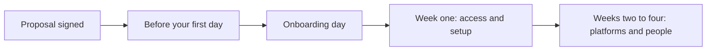

# 👋 Onboarding: Your Journey with Plainsight Begins
---
_Onboarding at Plainsight is designed to make you feel welcome, informed, and ready to hit the ground running 🏃‍♂️‍➡️_

On your first day the onboarding slides give you the introduction. This page is what you come back to afterwards: what to set up, what to learn, and where news reaches you. Work through it with your buddy, at your own pace.

## 📝 Before Your First Day
Once your proposal is signed, we start preparing for your arrival:

- **People team contact**: our People team reaches out to guide you through the first steps.
- **People Platform access**: you receive a link to our [People Platform](https://selfservice.officient.io), where you fill in what we need before your start date.
- **Mobility options**: we explain the mobility options you have at Plainsight. Feel free to take a peek at [🚲 Mobility](remuneration/mobility.md) already.
- **Event invitations**: you start receiving invites to our events, and you're welcome to join before your first day.

## 🚀 Onboarding Day
Your first day is about getting settled and connected:

- **Welcome kit**: your laptop, a mouse, a welcome gift, and time to set up your laptop the way you like it.
- **Orientation**: we walk you through how we work, the tools we use, and where to go with questions.
    - We transfer your phone subscription to our [Mobile Vikings account](https://mobilevikings.be).
    - You get added to our WhatsApp group.
    - If you chose a company car: you get the keys 🔑.
    - We take your picture for your accounts 📸.
- **Meet the team**: after the essentials, we plan time for you to meet your new colleagues.

## ✅ Your First Weeks

### Week one: access and setup

| System | What you use it for | How you get in |
|---|---|---|
| **Microsoft 365 and Teams** | Mail, calendar, chat and documents. The Plainsight team in Teams is where company news lands, with SharePoint underneath for files. | Your account is ready on day one. Set up the authenticator app straight away. |
| **Officient** | Contracts, holidays, illness, payslips | The invitation you received before your start date |
| **Harvest** | Time tracking: 40 hours a week, with a short note on what you did. Not on a client project yet? Book your time on Plainsight > Internal. | Invitation on day one. The desktop app is in the Microsoft Store. |
| **Plainsight Brain** | Our shared memory, and the quickest way to find the colleague who knows | [See below](#connect-to-the-plainsight-brain) |
| **Alan** | Hospitalisation insurance and health support | Invitation by mail, then everything runs through the app |
| **Commuty** | Parking at the Ghent office | Reserve in the app before you come |

More tools, and what we use them for, are in [🔨 Tools We Love](working/tools-we-love.md).

- [ ] Set up your laptop: new password, authenticator, Windows Hello, Office, Power BI Desktop, VS Code, SSMS and Harvest
- [ ] Sign your documents in Officient
- [ ] Join the Plainsight team in Teams and turn on notifications for the channels that matter to you
- [ ] Connect to the Plainsight Brain
- [ ] Put your CV in the Plainsight format: [📄 CV](working/cv-curriculum-vitae.md)
- [ ] Profile photo, email signature and LinkedIn banner (the templates are in Teams, under Digital Templates)

### Connect to the Plainsight Brain

Do this in week one, not "when you get to it". The Brain is our shared memory: what colleagues learned on other projects, the context of the project you're joining, this playbook and our standards.

It also knows who knows what. Ask it "who has worked for this client?" or "who has set up Unity Catalog before?" and it answers with names, plus where that came from: the project history, the CVs. In your first weeks that's the most useful question there is. It turns "I don't know who to ask" into a name and a Teams message. What it shows depends on your access rights, like everything else here.

| You work with | Set it up via |
|---|---|
| **Claude Code** | [🧠 Connect Plainsight Brain to Claude Code](../technical-guidelines/plainsight-ai/agentic-development/plainsight-brain.md): one command and a sign-in |
| **Another AI tool, or just your browser** | [🧠 AI-Native, In Plain Sight](../about-plainsight/ai-native.md): our AI Assistant, Codex, Cursor, Copilot and My Brain |

### Weeks two to four: platforms and people

Start with the platform of your first project. Read how we build on it first, then take the vendor's training: you'll recognise more of it.

| Platform | How we build it | Training to start with |
|---|---|---|
| **Microsoft Fabric** | [Lakehouse Architecture](../technical-guidelines/fabric/lakehouse-architecture.md) | [Microsoft Learn: Fabric](https://learn.microsoft.com/en-us/training/browse/?products=fabric) |
| **Databricks** | [Workspace Organisation](../technical-guidelines/databricks/workspace-organization.md) | [Databricks Academy](https://www.databricks.com/learn/training/home) |
| **dbt** | [Project Structure](../technical-guidelines/dbt/project-structure.md) | [dbt Learn](https://learn.getdbt.com/catalog) |
| **Power BI** | [Data Modelling in Power BI](../technical-guidelines/power-bi/data-modeling-in-power-bi.md) | [Microsoft Learn: Power BI](https://learn.microsoft.com/en-us/training/browse/?products=power-bi) |

Certifications we recommend: [Fabric Data Engineer (DP-700)](https://learn.microsoft.com/en-us/credentials/certifications/fabric-data-engineer-associate/) or [Fabric Analytics Engineer (DP-600)](https://learn.microsoft.com/en-us/credentials/certifications/fabric-analytics-engineer-associate/), [Databricks Data Engineer Associate](https://www.databricks.com/learn/certification/data-engineer-associate), and [Azure Solutions Architect](https://learn.microsoft.com/en-us/credentials/certifications/azure-solutions-architect/) if you build platforms. Your career coach helps you plan them: see [🌱 Learning and Experimentation](working/learning-and-experimentation.md).

- [ ] Read our guidelines for the platform of your first project
- [ ] Start the training for that platform
- [ ] Join the [knowledge hub](../about-plainsight/knowledge-hubs.md) for your platform: it's where colleagues share what they learn on projects
- [ ] Plan your first certification with your career coach
- [ ] Optional: write your "Get to know me" blog for our website. It earns you [Stars](remuneration/rewards-stars-and-clouds.md).

## 📣 How We Keep Each Other Informed

About every six weeks the whole company meets for an evening session, alternating between our [Ghent and Mechelen offices](working/our-offices-and-locations.md). It opens with a short company update: where we stand, our goals, HR news, who joined and the shout-outs. Then one or two knowledge sharing sessions, depending on how much time the topic needs. Your first one is the easiest way to meet everyone at once.

| Channel | What reaches you there |
|---|---|
| **Company update and evening session** | Where we stand and what's coming, then knowledge sharing |
| **Teams, the Plainsight team** | Day-to-day news, questions and documents |
| **WhatsApp group** | The informal side. It's optional: important news always comes through Teams or mail. |
| **Event invitations** | Teambuildings, trainings, webinars, in your calendar |
| **Your career coach** | Your growth, your goals, and anything you'd rather discuss one-on-one: see [🎯 Evolution Process](working/evolution-process.md) |
| **This playbook and the Brain** | How we work, and what colleagues have learned |

## 🎓 Plainsight Academy
Every September, we host the Plainsight Academy: a five-week training program to kickstart your journey with us.

- **Colleague-led trainings**: our own experts lead these sessions and bring their project experience.
- **Soft skills**: external trainers join for the soft skills, so you're ready for the client as well as the code.

This onboarding process is crafted to give you the tools, knowledge and connections you need to thrive at Plainsight from day one.
