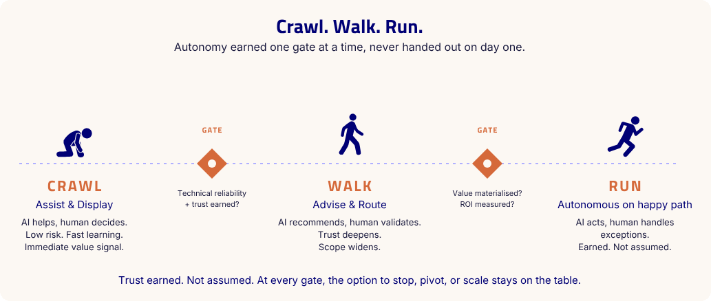
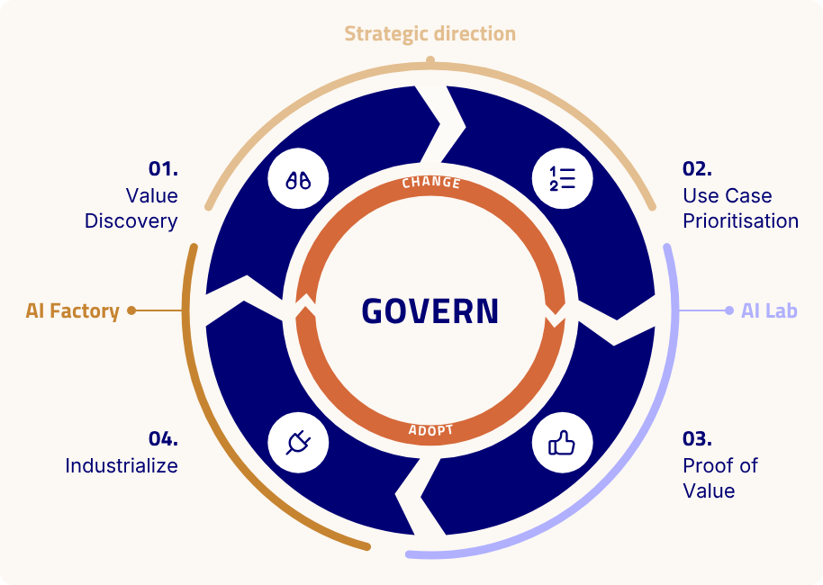

# AI 🤖

> **AI built into the work. Not bolted onto it.**

Pilots are easy. Production is hard, and the model is rarely the reason. What makes it hard is the integration into systems people already use, the data that has to flow into it, and the people who have to want to use it. That's where we spend our time: GenAI, machine learning, automation and agents, built into the systems a client already runs.

On the website: [plainsight.pro/ai](https://www.plainsight.pro/ai).

## Where AI creates value

There is no fixed order, and it's rarely just one.

| Where | What it looks like |
|---|---|
| **Personal efficiency** | An everyday AI assistant for drafting, search and summarising, so routine work stops eating the day. |
| **Team use cases** | A process that eats time, analysed and made faster: the repetitive steps, the triage, the handoffs, the answers people keep asking for. |
| **Strategic bets** | AI and custom apps that change how the business competes, instead of only trimming cost. |
| **Agentic coding enablement** | The client's own developers learning to build the agentic way, with the frameworks and rails we use ourselves. |

## Crawl, walk, run

We don't hand anyone autonomous AI on day one. Every use case moves through three stages, with a gate between each. At every gate the client can stop, pivot or scale.

| Stage | AI | People | Gate to the next stage |
|---|---|---|---|
| **Crawl** · assist & display | Helps | Decide | Technically reliable, and trust earned? |
| **Walk** · advise & route | Recommends | Validate | Value materialised, and ROI measured? |
| **Run** · autonomous on the happy path | Acts | Handle the exceptions | |

Trust earned, not assumed. When you scope a use case, plan the gates and what each one measures before you plan the sprints.

## From idea to production

Once the direction is set, use cases go round a four-step cycle: value discovery, use case prioritisation, proof of value, industrialise. Governance sits at the core, change and adoption run through every step. The AI Lab prioritises and proves; the AI Factory industrialises.

{ width="600" }

Build it so the next one is cheaper. Build-only ships one use case. Build-and-embed builds the capability to keep shipping: same first delivery, very different year two. Three things are non-negotiable on every AI project: measured ROI, real ownership, and a clean exit option.

## Agentic development, together

We build the agentic way every day, on real client work, with our own Agentic Development Framework underneath. We share it with client teams in four formats:

| Format | For whom |
|---|---|
| **AI inspiration session** | Leadership teams getting their bearings |
| **Engineering hackathon** | The client's team building with ours, on their real problem |
| **Paired development** | Side by side on a live use case |
| **Framework walkthrough** | How we build end to end: the rails, the reviews, the shortcuts that don't break things |

Our own setup is in the playbook: [🧠 AI-Native, In Plain Sight](../about-plainsight/ai-native.md) and [🧠 Claude Code Extensibility](../technical-guidelines/plainsight-ai/agentic-development/skills.md).

We build with Microsoft, Databricks, Anthropic (Claude) and open source tools. See [🤝 Partnerships](../partners/partnerships.md).

!!! tip "Smaller organisations"
    For SMEs there's a step-by-step track from strategy to a first working use case, built on the same crawl-walk-run stages: [AI Compass](https://www.plainsight.pro/aicompass_en).

## Where to Go Next

| Topic | Page |
|---|---|
| Deciding which use cases come first | [🗺️ Strategy](strategy.md) |
| The data an AI use case runs on | [📊 Data & Analytics](data-and-analytics.md) |
| The software an AI solution lives in | [💻 Software Engineering](software-engineering.md) |
