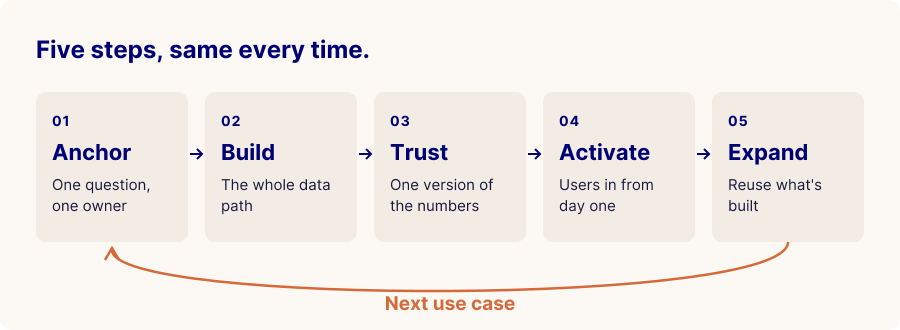

# Data & Analytics 📊

> **Data foundations, built one use case at a time.**

Data is the layer everything else sits on: analytics, AI, automation. Without trusted data in the right place, nothing on top of it holds up. That doesn't mean a client needs a multi-year platform rebuild first. We pick one real business question, build the data path end to end, ship something people trust, and grow the platform from there.

On the website: [plainsight.pro/analytics](https://www.plainsight.pro/analytics).

## What we build

| Area | What it covers | Our standards |
|---|---|---|
| **Data platforms** | Databricks, Fabric or Azure-native, designed for the client's data volume, team maturity and roadmap | [Databricks](../technical-guidelines/databricks/compute-selection.md) · [Fabric](../technical-guidelines/fabric/workspace-organization.md) |
| **Data engineering** | Ingestion, transformation and orchestration. Tested, monitored, and built so the client's team can maintain it | [Architectural principles](../technical-guidelines/architectural-principles/data-layers-and-modeling.md) · [dbt](../technical-guidelines/dbt/project-structure.md) |
| **Dashboards & analytics** | Power BI with shared semantic models, consistent definitions, and governance that enables instead of blocks | [Power BI](../technical-guidelines/power-bi/data-modeling-in-power-bi.md) |

Fabric or Databricks? Both. We're a partner of Microsoft and Databricks, and we choose based on where the client's data and team already are, not on what we'd rather sell.

## Five steps, same every time

Not because we like process. Skipping steps is how data projects become the ones everyone has a story about.

| Step | What it means on your project |
|---|---|
| **Anchor** | Not a wish list of datasets. If we can't name the decision the data will change, we don't start. |
| **Build** | Source to dashboard, or source to model. We don't half-build the middle layer and call it a foundation. |
| **Trust** | Data contracts, tests, lineage. People stop asking which version is right, because there is only one. |
| **Activate** | The people who'll live with it are involved from day one. Training isn't an event at the end. It's how we built it. |
| **Expand** | The next use case reuses what's already built. The platform grows because it's useful, not because someone drew an architecture diagram. |

## Accelerators

Each one started as a pattern we kept repeating at clients. Use them on your project before you build the same thing again.

| Accelerator | What it does |
|---|---|
| [Fabric Rollout Planner](https://fabricplanner.plainsight.pro/home) | Eight questions in. Terraform, CI/CD pipelines, a compliance justification and an interactive rollout plan out, in about five minutes. |
| [Databricks Rollout Planner](https://databricksplanner.plainsight.pro/home) | The same for Databricks, including workspaces and Unity Catalog. |
| [AI-Driven Migration](https://migration.plainsight.pro) | Moves SSIS, Azure Data Factory and Synapse pipelines to Fabric or Databricks. Agents scan the estate and generate the target; an expert signs off at every gate. |
| [Workbook Connect](https://www.plainsight.pro/products) | Master data managed from Excel: an add-in on Azure SQL, SQL Server and Fabric, with validation rules and data quality checks built in. |

## What's changing: Generative BI

"Will we still build dashboards, or will we just ask a data agent?" Clients ask it in almost every conversation now. Short answer: people will talk to their data more and more, but whether they can trust the answer depends far less on the agent than on how well the semantic model underneath was prepared for it. That's the part nobody demos, and it's our work. More on [plainsight.pro/analytics/genbi](https://www.plainsight.pro/analytics/genbi).

## Where to Go Next

| Topic | Page |
|---|---|
| Putting AI on top of this foundation | [🤖 AI](ai.md) |
| Software around the data | [💻 Software Engineering](software-engineering.md) |
| All offerings on one page | [🧭 What We Offer](what-we-offer.md) |
