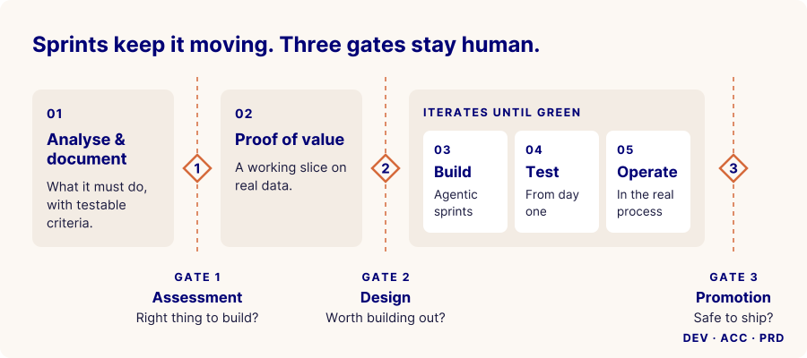

# Software Engineering 💻

> **Custom software that runs your business.**

Applications, platforms, and the integration that ties them to the systems a client already runs, ERPs included. When a data or AI project needs somewhere to live, we build that too.

The value in software was never the code. It sits in the data, the context and the process underneath, and that's the part we already know: most of our software work grows out of a data or AI project, so we've seen how the business actually runs. We build the right thing, not just the thing the brief described.

On the website: [plainsight.pro/software-engineering](https://www.plainsight.pro/software-engineering).

## What we build

| Shape of work | What it looks like |
|---|---|
| **Business process engineering** | Data and agents turning a manual process into an automated one, like invoicing or order handling wired straight into the ERP. Usually where the biggest savings hide. |
| **Custom software and platforms** | Applications built around a real need, replacing spreadsheets, manual steps and the gaps between tools. Built to be used, owned and maintained by the client's team. |
| **Integration** | Connecting to the ERPs and CRMs a client already runs. Because we know their data, this is often simpler and cheaper than the usual integrator route. |

Not every piece of software has AI in it. But many builds get sharper with AI, and an AI solution usually needs software to live in.

## How we work

| | Step | What it means on your project |
|---|---|---|
| 01 | **Start from a spec** | A functional analysis before we build: what it does, for whom, and how we'll know it works. Requirements with testable acceptance criteria, prioritised and agreed with the client. |
| 02 | **Build the agentic way** | A disciplined lifecycle, no cowboy work, with agentic coding. The client's developers work alongside ours, so the people who will maintain it have been writing it from the start. |
| 03 | **Testing built in** | A testing framework from day one, largely agent-driven. What we ship keeps working as it grows. |
| 04 | **Deploy and hand over** | Shipped into the client's cloud, wired into their systems, tested against the real process, documented, and owned by their team. |

## Scrum, with gates

Speed should never cost control. The gates are mandatory, a person decides at each one, and nothing passes without sign-off from the client.

| Gate | Question | Comes after |
|---|---|---|
| **1 · Assessment** | Is this the right thing to build? | Analyse & document |
| **2 · Design** | Is it worth building out? | Proof of value: a working slice on real data, in front of real users |
| **3 · Promotion** | Is it safe to ship? From DEV to ACC to PRD | Build, test and operate, looping until everything comes back green |

How we set this up with Claude Code and the Plainsight Brain: [🧠 Claude Code Extensibility](../technical-guidelines/plainsight-ai/agentic-development/skills.md).

## Where to Go Next

| Topic | Page |
|---|---|
| AI inside the software | [🤖 AI](ai.md) |
| The data the software runs on | [📊 Data & Analytics](data-and-analytics.md) |
| Keeping it running after go-live | [🧩 Experts](experts.md) |
