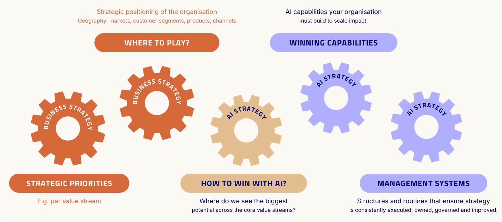
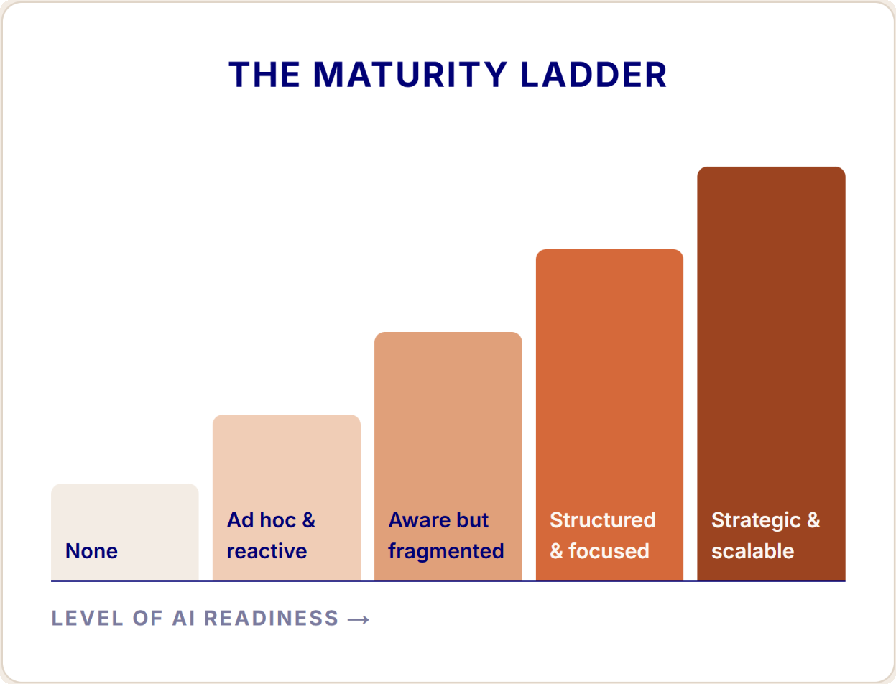
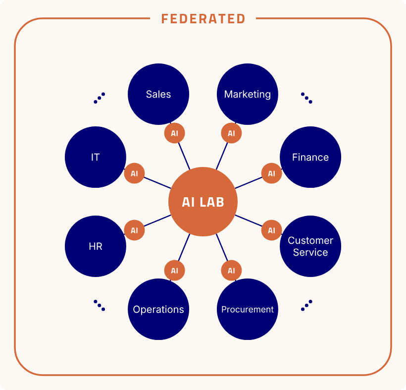

# Strategy 🗺️

> **It starts with your business. Not our tech stack.**

Strategy turns business questions into a data, AI and software direction an organisation can follow. Not a slide deck that gathers dust: priorities people agree on, owners with names, and guardrails that make experimenting safe.

The missing layer is rarely technical. Most clients already have tools, dashboards and a few AI pilots. What's missing is clarity: who owns what, which investments connect to business outcomes, and where data and AI should work together. Five strong guiding principles beat fifty slides nobody opens after the workshop.

On the website: [plainsight.pro/strategy](https://www.plainsight.pro/strategy).

## Three pillars

| Pillar | What we work on |
|---|---|
| **Direction** | Data roadmaps, AI strategy, use case prioritisation. Where data and AI help, and where they don't. |
| **Ownership & Governance** | Data governance, decision rights, AI guardrails. Good governance speeds things up, because fewer decisions get reopened every quarter. |
| **Adoption & Change** | Change and communication, AI Lab setup, AI champions. A strategy has to live inside the organisation, not on a consultant's laptop. |

## Where to play, how to win

Business strategy decides where to play. AI strategy decides how to win there, which capabilities to build, and which routines keep it running. If those gears don't mesh, AI stops serving the strategy and becomes a cost.

## Six workstreams

Six workstreams cover the arc from readiness to adoption. Not every engagement needs all six: we scope what fits.

| # | Workstream | Target outcome |
|---|---|---|
| 1 | **AI Maturity Scan** | A fact-based view of AI readiness, capability gaps and priority areas, agreed with the client |
| 2 | **From AI strategy to value** | A focused AI strategy turned into a prioritised portfolio of use cases, the first ones already moving into build |
| 3 | **Governance & operating framework** | Clear ownership and decision rights, and an AI Lab, so AI runs as a capability instead of a string of one-off initiatives |
| 4 | **Scalable AI architecture** | An architecture blueprint, fewer and better-chosen AI tools, and reusable data foundations |
| 5 | **Data readiness** | Named data owners and stewards accountable for quality at the source, and practical guardrails for responsible AI use |
| 6 | **AI change & enablement** | Adoption that sticks: communication, leadership alignment and engaged AI champions |

### The AI Maturity Scan

Before building anything, find out where the client stands. The scan combines qualitative and quantitative assessment, and scores six dimensions on a five-level ladder: strategic direction; data; tools & technology; governance & compliance; organisation & processes; people, skills & culture.

{ width="520" }

The client walks away with a baseline per dimension, the capability gaps and AI champions we found, a first view of their data readiness, and the priority areas to work on. Details on [plainsight.pro/strategy/ai-maturity-scan](https://www.plainsight.pro/strategy/ai-maturity-scan).

### The AI Lab

A cross-functional hub that helps the business test AI ideas, prove their value and hand the successful ones over to be built at scale. It has two jobs: decide which use cases to pilot and scale, and give teams a safe place to experiment.

{ width="480" }

In the federated set-up, the lab holds the expertise, standards and tooling, and every department has its own AI expert who knows the business. Four roles make it work:

| Role | Owns |
|---|---|
| **AI product owner** | The prioritised use case backlog and the value it delivers. Measured on use cases in production. |
| **Data owner** | Data quality, definitions, lineage and compliance. No reliable data, no reliable AI. |
| **AI champion** | Adoption on the work floor: helps colleagues use AI and brings practical feedback back. |
| **Process owner** | Embedding AI in the way of working, from the process as it is to the process as it should be. |

## How an engagement runs

Workshops before reports. Co-creation over handoffs. We don't disappear for six weeks and come back with a deck.

| Step | What happens |
|---|---|
| **Listen** | Understand the real questions. Talk to leadership and teams. Find where the friction lives. |
| **Map** | Make the current state visible: opportunities, gaps, and the things nobody talks about yet. |
| **Prioritise** | Not everything deserves investment now. Balance value, feasibility and readiness. |
| **Define** | Roadmap, governance model and operating principles. Practical, visual, usable. |
| **Activate** | Connect strategy to execution, and set up the structures that keep it alive. |

The output is an AI action plan that gives three things: **direction** (where to invest and why those choices beat the alternatives), **confidence** (an honest baseline and guardrails, not a 40-page policy) and **alignment** (shared language and ownership, so the plan moves forward together).

!!! tip "Smaller organisations"
    For SMEs, the same approach comes as a step-by-step track with fixed packages, from strategy to a first working use case: [AI Compass](https://www.plainsight.pro/aicompass_en).

## Where to Go Next

| Topic | Page |
|---|---|
| How a use case moves from pilot to production | [🤖 AI](ai.md) |
| The data foundation underneath | [📊 Data & Analytics](data-and-analytics.md) |
| All offerings on one page | [🧭 What We Offer](what-we-offer.md) |
