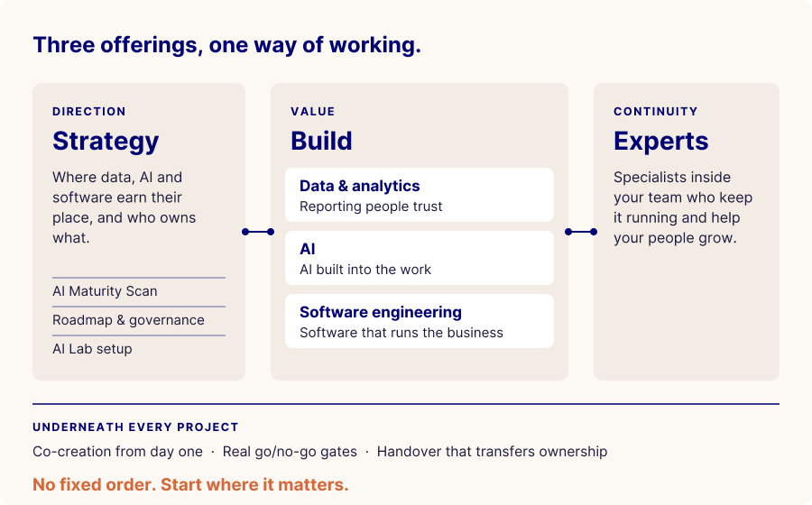

# What We Offer 🧭

> **Strategy gives direction. Building creates value. Specialists protect it.**

Clients meet Plainsight through three offerings. This section is the shared version for everyone inside: the same names and structure as [plainsight.pro](https://www.plainsight.pro), plus how we deliver, which a website can only hint at. If you can explain this page to a client in two minutes, you know what we sell.

## Three offerings

| Offering | What the client gets | Read more |
|---|---|---|
| **Strategy** · direction | A data, AI and software direction the organisation can follow: priorities people agree on, owners with names, and guardrails that make experimenting safe. | [🗺️ Strategy](strategy.md) |
| **Build** · value | Working solutions in three domains: analytics people trust, AI built into the work, and software that runs the business. | [📊 Data & Analytics](data-and-analytics.md) · [🤖 AI](ai.md) · [💻 Software Engineering](software-engineering.md) |
| **Experts** · continuity | Specialists inside the client's team who keep what was built running and help the client's own people grow. | [🧩 Experts](experts.md) |

There is no fixed order. One client starts with a strategy, the next with a report nobody trusts, a third needs an extra engineer next month. A client can start anywhere, and each offering makes the next one easier.

## One way of working

Three domains, different problems, one way of building. Whichever domain a project sits in, the same three things show up.

| | What it means on your project |
|---|---|
| **Co-creation from day one** | We build with the client's people, not for them. Pair with their developers and analysts. By go-live, the people who will maintain it have been writing it since week one. |
| **Real go/no-go gates** | Every project has them: budget projected, value measured, and a clean way to stop. Failing a gate isn't failure. It's the system working. |
| **Handover that transfers ownership** | Runbooks, documentation, and ownership assigned to a name. The bar: it runs without us on call. |

Before a bigger move, we check two things: the client's people understand what AI can do, and their data can carry it. That's the difference between a win that sticks and one that doesn't.

## How this maps to our organisation

Internally, offer leads look after Data/AI Strategy & Governance, Data & Analytics, and AI & Software Engineering (see [🏗️ How We're Organised](../about-plainsight/how-were-organised.md)). Same work, cut the way we organise and sell it. Projects and Experts draw on the same people, which is why one colleague can be on a strategy track this quarter and in a client's data team the next.

## Where to Go Next

| Topic | Page |
|---|---|
| Direction, governance and the AI Maturity Scan | [🗺️ Strategy](strategy.md) |
| Data platforms, pipelines and reporting | [📊 Data & Analytics](data-and-analytics.md) |
| GenAI, machine learning, agents, crawl-walk-run | [🤖 AI](ai.md) |
| Custom software, integration and gates | [💻 Software Engineering](software-engineering.md) |
| Specialists in the client's team | [🧩 Experts](experts.md) |
| How clients log an issue | [🛠️ Support](support.md) |
