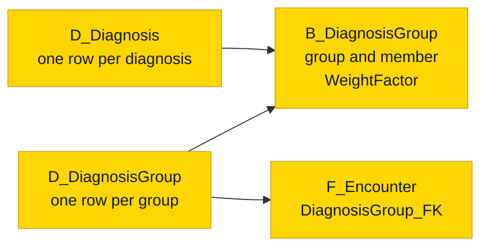
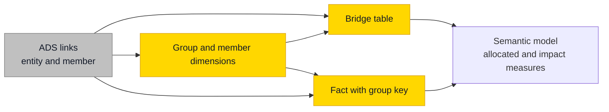

# Bridge Tables and Multivalued Dimensions

## Overview

A star schema assumes each fact row points at one member of each dimension. Reality disagrees: a hospital visit has three diagnoses, a bank account has two holders. That is a **multivalued dimension**, and a bridge table is how you model it without counting the money twice.



Arrows show how filters flow. Not every many-to-many needs a bridge. Pick the lightest option that still answers the question.

| Option | How it works | Use it when |
| ------ | ------------ | ----------- |
| Primary member | The fact points at one member, such as the primary diagnosis | The business agrees that one member is enough |
| Fixed attributes | One flag or column per member on the dimension | The list is short and stable, like a few product features |
| **Bridge with weighting factor** | A group key on the fact, a bridge row per member with its share | The list varies per row and totals must stay right |
| Allocated fact | The load splits the fact into one row per member | Every report wants the allocated view and nobody needs the original row |

## Practical Examples

### The double counting problem

A visit billed at 1000 has two diagnoses. Join straight through and the visit appears twice.

| Report | Diagnosis A | Diagnosis B | Sum of the rows | True total |
| ------ | ----------- | ----------- | --------------- | ---------- |
| Without weights (impact view) | 1000 | 1000 | ==2000== | 1000 |
| With weights 0.6 and 0.4 (allocated view) | 600 | 400 | 1000 | 1000 |

Both views are legitimate. "How much revenue involved diagnosis A?" is an impact question and 1000 is the right answer, provided nobody adds the rows up. Label the measures so nobody has to guess which one they are reading.

### The structure

```sql
CREATE TABLE B_DiagnosisGroup
(
    DiagnosisGroup_FK BIGINT NOT NULL,
    Diagnosis_FK BIGINT NOT NULL,
    WeightFactor DECIMAL(9,6) NOT NULL
    -- Technical columns as on Star - Dimension Tables
);

-- The fact carries the group, not the members
-- DiagnosisGroup_FK BIGINT NOT NULL
```

The same set of members can reuse the same group key, so the bridge stays small. A fact without any member points at the `-1` or `-2` [special member](star-dimension-tables.md#special-dimension-members) of the group dimension, and the foreign key stays `NOT NULL`.

Two tests carry this table. Both must return zero rows.

```sql
-- Weights add up to 1 within each group
SELECT DiagnosisGroup_FK
FROM B_DiagnosisGroup
GROUP BY DiagnosisGroup_FK
HAVING ABS(SUM(WeightFactor) - 1.0) > 0.0001;

-- A member appears once per group
SELECT DiagnosisGroup_FK, Diagnosis_FK
FROM B_DiagnosisGroup
GROUP BY DiagnosisGroup_FK, Diagnosis_FK
HAVING COUNT(*) > 1;
```

### Choosing the weights

The weighting factor is a business decision, so get it from the people who own the number. Equal shares are a fine start when nobody can say otherwise, as long as the report says so. Write the rule next to the table.

### Querying it

```sql
SELECT d.DiagnosisName,
       SUM(f.BilledAmount * b.WeightFactor) AS AllocatedAmount,
       SUM(f.BilledAmount) AS ImpactAmount    -- Do not add this column up
FROM F_Encounter AS f
JOIN B_DiagnosisGroup AS b ON b.DiagnosisGroup_FK = f.DiagnosisGroup_FK
JOIN D_Diagnosis AS d ON d.Diagnosis_SK = b.Diagnosis_FK
GROUP BY d.DiagnosisName;
```

### Bridges that change over time

An account gets a second holder in June. Put validity columns on the bridge and treat them like any other history: half-open interval, `NULL` for the current row, and the same as-of join as on [Slowly Changing Dimensions](slowly-changing-dimensions.md#type-2-track-history).

| Account_FK | Customer_FK | WeightFactor | T_ValidFromDateTime | T_ValidToDateTime |
| ---------- | ----------- | ------------ | ------------------- | ----------------- |
| 700 | 11 | 1.000000 | 1900-01-01 00:00:00 | 2026-06-01 00:00:00 |
| 700 | 11 | 0.500000 | 2026-06-01 00:00:00 | NULL |
| 700 | 12 | 0.500000 | 2026-06-01 00:00:00 | NULL |

The weight test then applies per group at every point in time.

### In Power BI

Keep every relationship single-direction. A filter on a diagnosis reaches the bridge by itself, and the measure lets it continue through the group to the fact. [Data Modeling in Power BI](../power-bi/data-modeling-in-power-bi.md) explains why, and what changes when the model uses Row-Level Security.

```dax
Allocated Amount =
SUMX (
    B_DiagnosisGroup,
    B_DiagnosisGroup[WeightFactor]
        * CALCULATE (
            SUM ( F_Encounter[BilledAmount] ),
            CROSSFILTER ( B_DiagnosisGroup[DiagnosisGroup_FK], D_DiagnosisGroup[DiagnosisGroup_SK], BOTH )
        )
)
```

## Do's & Don'ts

| Do | Don't |
| -- | ----- |
| Start from the lightest option that answers the question | Build a bridge for a list of three stable flags |
| Agree the weights with the business and document the rule | Invent an allocation and hide it in a load |
| Test that weights sum to 1 per group | Assume the source delivers clean shares |
| Offer an allocated and an impact measure, clearly named | Let a report sum impact rows |
| Use integer keys on both sides of the bridge | Relate on a concatenated text list of members |

## Where It Fits



## Related Topics

- [Star - Dimension Tables](star-dimension-tables.md) - Dimension design and special members
- [Star - Fact Tables](star-fact-tables.md) - Grain and dimension keys
- [Surrogate, Primary & Foreign Keys](surrogate-primary-and-foreign-keys.md) - Why relationships use integers
- [Data Modeling in Power BI](../power-bi/data-modeling-in-power-bi.md) - Relationship direction and the semantic layer

---

## Sources

Ralph Kimball & Margy Ross, [*The Data Warehouse Toolkit*](https://www.kimballgroup.com/data-warehouse-business-intelligence-resources/books/data-warehouse-dw-toolkit/) (3rd Edition, Wiley, 2013), and the [Kimball dimensional modeling techniques](https://www.kimballgroup.com/data-warehouse-business-intelligence-resources/kimball-techniques/dimensional-modeling-techniques/). Implementation choices come from Plainsight projects on SQL Server, Fabric and Databricks.
