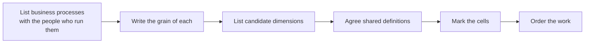
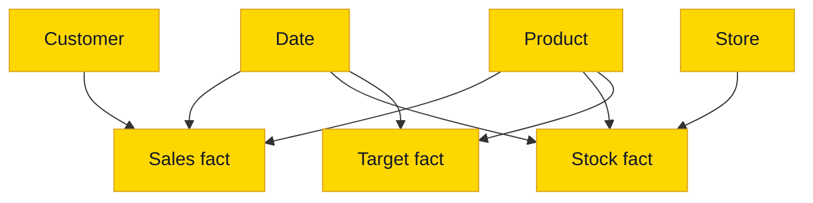

# Bus Matrix

## Overview

The bus matrix is the most useful table that never gets loaded. Rows are business processes, columns are conformed dimensions, and a mark says that this process uses this dimension. One page, and everyone can see what the data platform is going to be.

| Business process | Fact table | Date | Customer | Product | Salesperson | Store | Promotion |
| ---------------- | ---------- | :--: | :------: | :-----: | :---------: | :---: | :-------: |
| Sales orders | `F_Sales` | X | X | X | X | | X |
| Invoicing | `F_Invoice` | X | X | X | X | | |
| Stock levels | `F_Stock_Daily` | X | | X | | X | |
| Sales targets | `F_SalesTarget` | Month | | Category | X | | |
| Promotion coverage | `F_PromotionCoverage` | X | | X | | X | X |

Read a **column** to see who shares a dimension: build `Product` once, and five facts use it. Read a **row** to see what a process needs before you can deliver it. A cell can name a coarser level, like `Category` or `Month`. That fact then shares a rollup of the conformed dimension, not a second dimension.

## Practical Examples

### Building one

Do this with the people who run those processes, on a whiteboard, before anyone writes a model. Rows are processes such as "invoicing", not departments and not reports. One report usually draws on several processes, and one department usually runs several. The hard part is the conversation about columns: when sales and finance both say "customer", do they mean the same thing? Better to find out in a workshop than in a reconciliation.

### What it tells you

| Situation | What the matrix shows | What to do |
| --------- | --------------------- | ---------- |
| Where to start | The column with the most marks and the row with the most value | Build that dimension and that fact first |
| A new fact is requested | Which dimensions already exist | Add the row first, and reuse the existing dimensions |
| Someone wants their own `D_Customer` | A column that already exists | Extend the conformed dimension instead |
| Actual versus budget | Two rows with marks in the same columns | They can share a visual, because the dimensions conform |
| Two rows share no columns | Nothing connects these processes | Don't promise a combined report yet |

### Conformed means one

A conformed dimension has one grain, one set of surrogate keys and one meaning, and every fact reuses it. In a semantic model it is one shared table with a relationship to each fact, which is what makes actual versus budget a single measure on a single axis. Details are on [Star - Dimension Tables](star-dimension-tables.md#conformed-dimensions).

### Keeping it alive

The matrix lives in the data architecture document of the project, next to the layer definitions. It changes in the same pull request as the model it describes. A matrix that lags behind the model tells you nothing, and a matrix on a slide from the kickoff is decoration.

## Do's & Don'ts

| Do | Don't |
| -- | ----- |
| Make rows business processes | Make rows reports or departments |
| Build it with the people who run the processes | Draft it alone and present it |
| Reuse the conformed dimension | Rebuild a dimension per fact |
| Name the coarser level in the cell | Create a separate dimension for a rollup |
| Update it with every new fact | Leave it in the kickoff deck |

## Where It Fits

## Related Topics

- [Star - Dimension Tables](star-dimension-tables.md) - Conformed and role-playing dimensions
- [Star - Fact Tables](star-fact-tables.md) - Grain and dimension keys
- [Fact Table Types](fact-table-types.md) - The type of each row in the matrix
- [Data Layers and Modeling](data-layers-and-modeling.md) - Where the dimensional model sits

---

## Sources

Ralph Kimball & Margy Ross, [*The Data Warehouse Toolkit*](https://www.kimballgroup.com/data-warehouse-business-intelligence-resources/books/data-warehouse-dw-toolkit/) (3rd Edition, Wiley, 2013), and the [Kimball dimensional modeling techniques](https://www.kimballgroup.com/data-warehouse-business-intelligence-resources/kimball-techniques/dimensional-modeling-techniques/). Implementation choices come from Plainsight projects on SQL Server, Fabric and Databricks.
