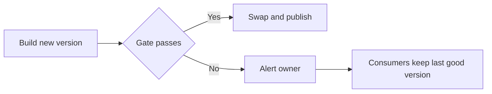
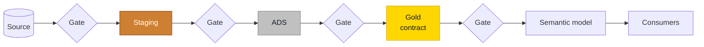

# Data Contracts and Quality Gates

## Overview

A **data contract** is a promise from whoever produces a table to whoever depends on it. A **quality gate** is the check that keeps the promise honest before anyone sees the data. The contract says what must be true. The gate stops the publication when it isn't.

| Part of the contract | What it answers | Example |
| -------------------- | --------------- | ------- |
| Owner | Who do I call? | The finance data team |
| Schema | Which columns, which types, which can be empty? | `Customer_FK BIGINT NOT NULL` |
| Grain and keys | What is one row? | One row per order line, `SalesOrderNo` + `SalesOrderLineNo` unique |
| Meaning | What does a value mean? | `SalesAmount` is net of discount, in EUR |
| Freshness | When is it there? | Loaded by 07:00 on business days |
| Quality | Which checks must pass? | The gate of that layer, below |
| Change policy | How will it change? | Breaking changes get a new version and an overlap period |

Each boundary between layers has its own gate, because each layer promises something different.

| Boundary | What the gate checks | When it fails |
| -------- | -------------------- | ------------- |
| Source to **Staging** | Schema matches, source not empty, row count within bounds of the previous load, freshness within threshold | Stop and alert. Staging keeps the last good load |
| Staging to **ADS** | Business keys unique and filled, accepted values on enumerations, casts succeed, control total reconciles with Staging | Stop publishing ADS and alert |
| ADS to **Gold** | Grain unique, Type 2 invariants, no orphan foreign keys, Unknown member count reported, control total reconciles with ADS | Stop publishing Gold and alert. Consumers keep the last good version |
| Gold to **Semantic model** | Refresh succeeded, control total matches Gold | Do not deploy the model and alert |

## Practical Examples

### A contract in dbt

In a dbt project the contract lives next to the model, in `_models.yml`, and the consumer is declared as an [exposure](../dbt/operations-and-testing.md).

```yaml
models:
  - name: f_sales
    description: "One row per order line. SalesAmount is net of discount, in EUR."
    config:
      contract:
        enforced: true
    columns:
      - name: sales_order_no
        data_type: int
        constraints:
          - type: not_null
      - name: sales_order_line_no
        data_type: smallint
        constraints:
          - type: not_null
      - name: customer_fk
        data_type: bigint
        constraints:
          - type: not_null
        tests:
          - relationships:
              to: ref('d_customer')
              field: customer_sk
      - name: sales_amount
        data_type: decimal(18,2)
    tests:
      - dbt_utils.unique_combination_of_columns:
          combination_of_columns:
            - sales_order_no
            - sales_order_line_no
```

A [dbt contract](https://docs.getdbt.com/docs/mesh/govern/model-contracts) guarantees the shape of a model at build time: names and data types. It does not guarantee the content, which is why the grain and relationship tests stay next to it.

### A declared constraint is not an enforced constraint

Fabric Warehouse, Databricks and BigQuery accept a `PRIMARY KEY` declaration without checking it. On Fabric, dbt only checks `not_null` at build time. The test is the real constraint.

| Check | dbt | Lakeflow | SQL Server or Fabric Warehouse |
| ----- | --- | -------- | ------------------------------ |
| Key unique | `unique`, `unique_combination_of_columns` | Expectation on an aggregating view | Query that must return zero rows |
| Not empty | `not_null` | Expectation with a warn, drop or fail policy | `NOT NULL` column, or a zero-row query |
| No orphans | `relationships` | Expectation on a join | Zero-row query against the dimension |
| Accepted values | `accepted_values` | Expectation | Zero-row query |
| Freshness | `freshness` on the source | Event log and alert | Compare the maximum timestamp with the threshold |
| Schema drift | Enforced contract, `on_schema_change: fail` | `schemaEvolutionMode`, rescued data column | Compare with `INFORMATION_SCHEMA` |
| Reconciliation | Singular test | Expectation or post-run query | Compare row count and a control total, record the result |

### Publish last

A gate only protects anyone if it runs before consumers can read the data. Build into a separate schema or table, run the gate there, then swap. When the gate fails, the swap doesn't happen and the reports show yesterday's correct numbers with yesterday's date, which beats today's wrong ones.



Record the result of every gate per run. A check that only speaks when it fails can't tell you it ran.

### Changing a contract

| Change | Breaking? | What to do |
| ------ | --------- | ---------- |
| Add a nullable column | No | Announce it |
| Remove or rename a column | Yes | New version, overlap period, tell every exposure owner |
| Change a data type | Usually | Treat as breaking unless it only widens |
| Change the grain | Always | A new table or version. Never in place |
| Change the meaning without changing the schema | Yes, and the nastiest one | Gross becomes net and no test fails. Same treatment as a rename |

Talk to the people who consume the table before you write the contract. A contract written only by its producer describes what was easy to deliver.

## Do's & Don'ts

| Do | Don't |
| -- | ----- |
| Name an owner on every contract | Publish a table nobody answers for |
| Put the gate before the publication | Test after consumers already read the data |
| Stop and alert when a blocking check fails | Log a warning that nobody reads |
| Test uniqueness on every engine, even with a declared key | Trust a `PRIMARY KEY` the engine does not enforce |
| Halt on an unexpected schema change | Widen or retype a target silently |
| Agree the contract with the consumers | Discover the consumers when something breaks |

## Where It Fits



## Related Topics

- [Medallion - Bronze Silver Gold](medallion-bronze-silver-gold.md) - What each layer promises
- [Analytical Data Store (ADS)](analytical-data-store-ads.md) - Quality rules in Silver
- [dbt Operations and Testing](../dbt/operations-and-testing.md) - Testing ladder and exposures
- [Lakeflow ETL Guide](../databricks/lakeflow-etl-guide.md) - Expectations on Databricks
- [Star - Fact Tables](star-fact-tables.md) - Why the grain is the key

---

## Sources

[dbt model contracts](https://docs.getdbt.com/docs/mesh/govern/model-contracts). Practices adapted from Plainsight projects on SQL Server, Fabric and Databricks.
