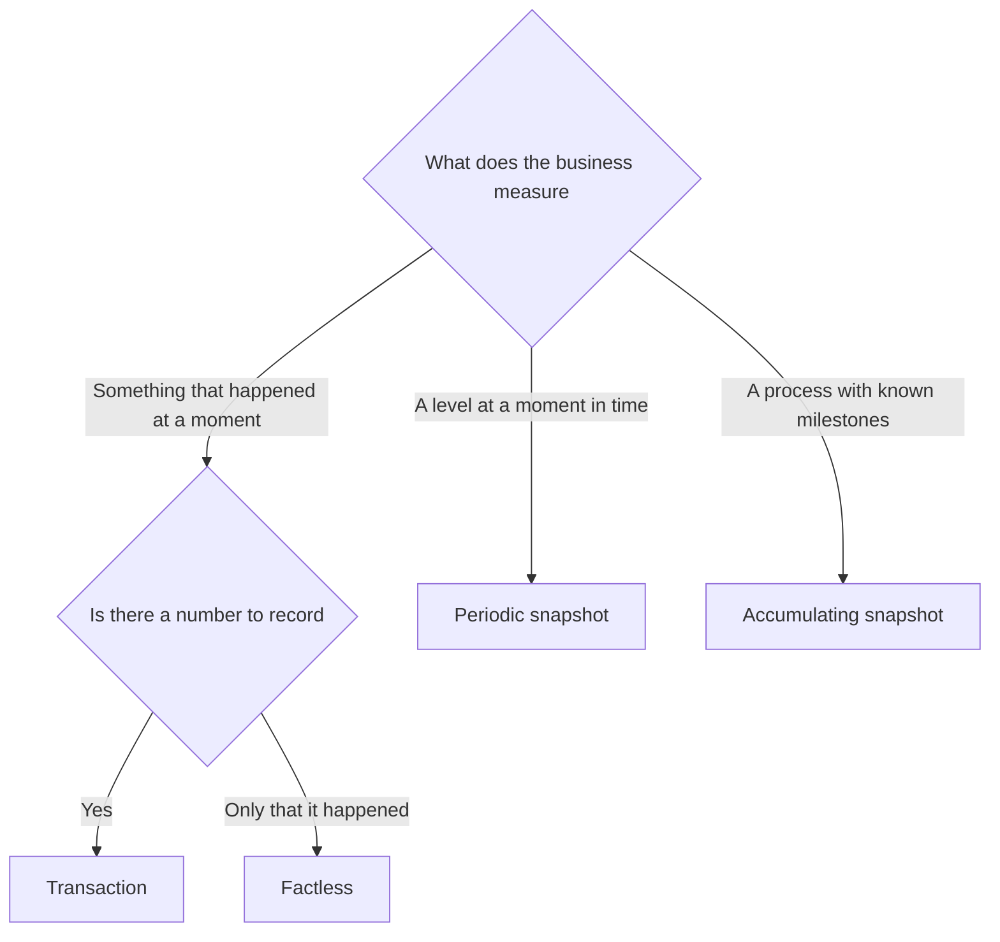
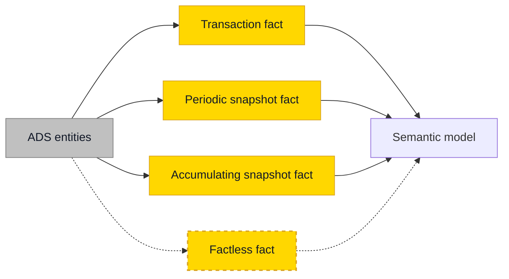

# Fact Table Types

## Overview

Every fact table is one of four types. Pick the type before you write a column, because it decides the grain, how rows change, and which measures can be summed.

| | Transaction | Periodic snapshot | Accumulating snapshot | Factless |
| - | ----------- | ----------------- | --------------------- | -------- |
| **One row per** | Event | Entity per period | Process instance | Event or coverage record, without a measure |
| **Example** | Order line, payment, page view | Month-end account balance, daily stock | Order line from placed to delivered, claim from filed to settled | Attendance, products on promotion |
| **What happens to a row** | Inserted once | Inserted per period, the open period may be rebuilt | Inserted once, then updated at each milestone | Inserted once |
| **Date keys** | One or a few | One snapshot date | One per milestone | One or a few |
| **Typical measures** | Additive amounts and quantities | Semi-additive balances and levels | Durations and lags between milestones | None, you count rows |
| **No activity means** | No row | Still a row | The row waits for the next milestone | No row |



Declare both the type and the additivity of each measure in the table specification, before writing the load.

| Additivity | Can you sum it | Examples | How to report it |
| ---------- | -------------- | -------- | ---------------- |
| **Additive** | Across every dimension | `SalesAmount`, `Quantity` | A plain sum |
| **Semi-additive** | Across every dimension except time | Account balance, stock level, headcount | Last or first value over time |
| **Non-additive** | Never | Unit price, margin percentage | Store the components, divide them in the measure |

## Practical Examples

All four types follow the same rule on keys from [Star - Fact Tables](star-fact-tables.md#primary-key): the grain is the key, and you test its uniqueness after every load.

### Transaction

The default, and the table on [Star - Fact Tables](star-fact-tables.md). Insert-only: a correction arrives as a new event or a reversal, whenever the source allows it.

### Periodic snapshot

Grain: one row per account per month-end.

```sql
CREATE TABLE F_AccountBalance_Monthly
(
    SnapshotMonth_Date_FK INT NOT NULL,      -- YYYYMMDD of the month-end
    Account_FK BIGINT NOT NULL,
    Customer_FK BIGINT NOT NULL,

    ClosingBalance DECIMAL(18,2) NOT NULL,   -- Semi-additive
    TransactionCount INT NOT NULL            -- Additive

    -- Technical columns as on Star - Fact Tables
);
```

The closing balance of a quarter is the balance of its last month, not the sum of three months. In Power BI that becomes a measure:

```dax
Closing Balance =
CALCULATE (
    SUM ( F_AccountBalance_Monthly[ClosingBalance] ),
    LASTNONBLANK ( 'Date'[Date], CALCULATE ( SUM ( F_AccountBalance_Monthly[ClosingBalance] ) ) )
)
```

!!! tip "Snapshots answer point-in-time questions"
    A periodic snapshot is modelled history you can query for years. Storage time travel is not. See [Time Travel and Bitemporal History](time-travel-and-bitemporal-history.md).

### Accumulating snapshot

Grain: one row per order line, for its whole journey. The row is revisited whenever a milestone happens.

```sql
CREATE TABLE F_OrderFulfilment
(
    -- Row handle for the milestone MERGE. Never loaded into the semantic model.
    OrderFulfilment_Key BIGINT NOT NULL,

    Placed_Date_FK INT NOT NULL,
    Picked_Date_FK INT NOT NULL,             -- -1 until the milestone happens
    Shipped_Date_FK INT NOT NULL,
    Delivered_Date_FK INT NOT NULL,
    Customer_FK BIGINT NOT NULL,
    Product_FK BIGINT NOT NULL,

    SalesOrderNo INT NOT NULL,
    SalesOrderLineNo SMALLINT NOT NULL,

    OrderedQuantity INT NOT NULL,
    DaysPlacedToShipped INT NULL,            -- NULL until both dates exist
    DaysShippedToDelivered INT NULL

    -- Technical columns as on Star - Fact Tables
);
```

| After the load of | Picked_Date_FK | Shipped_Date_FK | Delivered_Date_FK | DaysPlacedToShipped |
| ----------------- | -------------- | --------------- | ----------------- | ------------------- |
| 3 March (placed) | -1 | -1 | -1 | NULL |
| 4 March | ==20260304== | -1 | -1 | NULL |
| 6 March | 20260304 | ==20260306== | -1 | ==3== |
| 9 March | 20260304 | 20260306 | ==20260309== | 3 |

Three details decide whether this table stays honest:

| Detail | Rule |
| ------ | ---- |
| Milestone not reached | Foreign keys stay `NOT NULL` and point at the `-1` (_N/A) [special member](star-dimension-tables.md#special-dimension-members). Lags are `NULL` until both dates exist: averages skip a `NULL`, but they would count a zero |
| Physical key | This is one of the few fact tables that earns a single-column `BIGINT` key, as a handle for the update. It stays out of the semantic model |
| Other dimension keys | Decide once whether they stay at the version resolved when the row was created or follow the latest version, and write that in the specification |

### Factless

An **event** factless table records that something happened: this student attended this class on this day. Count the rows.

A **coverage** factless table records what could have happened, which is the only way to report on what did not. Which promoted products did not sell?

```sql
CREATE TABLE F_PromotionCoverage
(
    Date_FK INT NOT NULL,
    Product_FK BIGINT NOT NULL,
    Store_FK BIGINT NOT NULL,
    Promotion_FK BIGINT NOT NULL
    -- Technical columns as on Star - Fact Tables
);

SELECT c.Date_FK, c.Product_FK, c.Store_FK
FROM F_PromotionCoverage AS c
WHERE NOT EXISTS
(
    SELECT 1
    FROM F_StoreSales AS s
    WHERE s.Date_FK = c.Date_FK
      AND s.Product_FK = c.Product_FK
      AND s.Store_FK = c.Store_FK
);
```

## Do's & Don'ts

| Do | Don't |
| -- | ----- |
| Write the grain as one sentence and name the grain columns | Add a measure before the grain is settled |
| Keep one type per table | Mix event rows and month-end balance rows in one fact |
| Mark every measure additive, semi-additive or non-additive | Sum a balance across months |
| Build a snapshot next to its transaction fact when both questions exist | Rebuild balances at query time from years of transactions |
| Point unreached milestones at `-1` | Leave a date foreign key `NULL` |
| Keep the physical key of an accumulating snapshot out of the semantic model | Add a physical key to every fact out of habit |

## Where It Fits



## Related Topics

- [Star - Fact Tables](star-fact-tables.md) - Fact table structure, grain and keys
- [Star - Dimension Tables](star-dimension-tables.md) - The context around every fact
- [Bus Matrix](bus-matrix.md) - Which facts share which dimensions
- [Bridge Tables](bridge-tables.md) - When a fact row relates to several dimension members
- [Late-Arriving Dimensions and Facts](late-arriving-dimensions-and-facts.md) - Facts and dimensions that show up out of order

---

## Sources

Ralph Kimball & Margy Ross, [*The Data Warehouse Toolkit*](https://www.kimballgroup.com/data-warehouse-business-intelligence-resources/books/data-warehouse-dw-toolkit/) (3rd Edition, Wiley, 2013), and the [Kimball dimensional modeling techniques](https://www.kimballgroup.com/data-warehouse-business-intelligence-resources/kimball-techniques/dimensional-modeling-techniques/). Implementation choices come from Plainsight projects on SQL Server, Fabric and Databricks.
