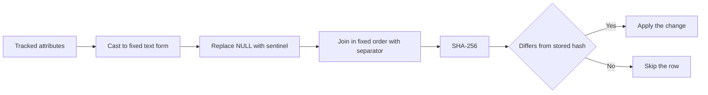
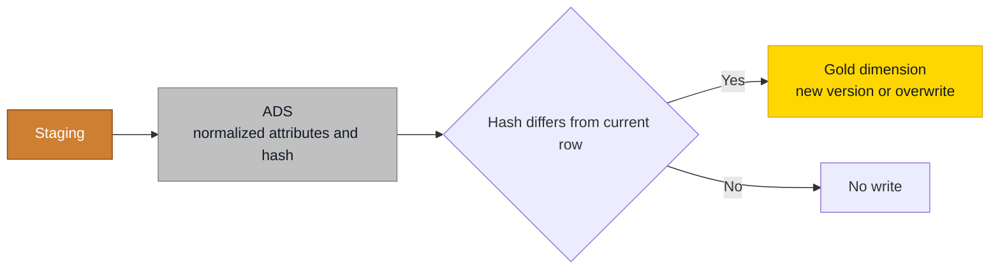

# Hash-Based Change Detection

## Overview

To know whether a customer changed, you can compare forty columns one by one, or compare one hash. The hash is shorter to write and cheaper to run, and it has exactly one way of going wrong: it reports "no change" when something changed. Every rule below exists to prevent that.



| Ingredient | Rule | What happens otherwise |
| ---------- | ---- | ---------------------- |
| Columns | Tracked attributes only, no technical columns and no load timestamp | Every load looks like a change |
| NULL | Cast the column, then `COALESCE` to a sentinel that can't occur in the data | Moving a value between columns goes unnoticed |
| Column order | One fixed, written-down order | A reordered list changes every hash |
| Separator | An explicit separator that can't occur in the data | `('ab', 'c')` and `('a', 'bc')` produce the same text |
| Text form | Fixed per data type: ISO dates, fixed decimal scale | `1.0` and `1.00` look like a change |
| Algorithm | SHA-256 | No reason to pick something weaker |

## Practical Examples

### Why `CONCAT_WS` is not enough

`CONCAT_WS` skips NULLs on SQL Server, Fabric Warehouse and Spark, separator included. Two different rows then become the same text.

```sql
SELECT CONCAT_WS('|', 'a', NULL, 'b');   -- a|b
SELECT CONCAT_WS('|', 'a', 'b', NULL);   -- a|b
```

The alternatives aren't safe on their own either. `CONCAT` on SQL Server turns a NULL into an empty string, and `concat` in Spark returns NULL as soon as one argument is NULL, after which `NULL <> hash` is never true and the change is never seen.

### T-SQL

```sql
SELECT
    CustomerNumber,
    HASHBYTES('SHA2_256', CONCAT(
        COALESCE(CAST(CustomerName AS VARCHAR(200)), '~NULL~'), '|',
        COALESCE(CAST(Segment      AS VARCHAR(50)),  '~NULL~'), '|',
        COALESCE(CONVERT(VARCHAR(10), BirthDate, 23), '~NULL~'), '|',
        COALESCE(CAST(CAST(CreditLimit AS DECIMAL(18,2)) AS VARCHAR(30)), '~NULL~')
    )) AS T_RowHash
FROM ADS_Customer;
```

Store it as `BINARY(32)`. On SQL Server columns that hold Unicode, cast to `NVARCHAR` instead so nothing is lost in the conversion.

### Databricks and Spark SQL

```sql
SELECT
    customer_number,
    sha2(concat(
        coalesce(cast(customer_name AS STRING), '~NULL~'), '|',
        coalesce(cast(segment AS STRING), '~NULL~'), '|',
        coalesce(date_format(birth_date, 'yyyy-MM-dd'), '~NULL~'), '|',
        coalesce(cast(cast(credit_limit AS DECIMAL(18,2)) AS STRING), '~NULL~')
    ), 256) AS t_row_hash
FROM ads.customer;
```

In dbt, put this in one macro and pass it the column list. `dbt_utils.generate_surrogate_key` already handles NULLs, but its separator is a hyphen, so for free-text columns a macro of your own is safer. Despite the name, its result is a text hash: fine for detecting change, not a key for Gold.

### Using the hash in a load

Compare against the current row only. This is the one place where a join on the current flag belongs, because the question is "did it change since the last version?", not "what was true at the event?".

```sql
SELECT s.CustomerNumber
FROM ADS_Customer AS s
JOIN D_Customer AS t
  ON  t.CustomerNumber = s.CustomerNumber
  AND t.T_IsCurrent = 1
WHERE t.T_RowHash <> s.T_RowHash;
```

A dimension that mixes [SCD types](slowly-changing-dimensions.md) needs two hashes, because the two outcomes are different.

| Hash | Contains | When it differs |
| ---- | -------- | --------------- |
| `T_Type2Hash` | Type 2 attributes | Close the current row, insert a new version |
| `T_Type1Hash` | Type 1 attributes | Overwrite in place |

Type 0 attributes go in neither.

### The hash is not a key

It detects change. It does not identify a row. Relationships use `BIGINT` [surrogate keys](surrogate-primary-and-foreign-keys.md). On an engine without an identity column, a deterministic 64-bit integer hash is a tolerated fallback for generating a key, and it is never a hex string. A hash of the business key alone can't tell the versions of a Type 2 row apart, so it must include the validity start.

### Traps

| Trap | Symptom | Fix |
| ---- | ------- | --- |
| A tracked column is added | Every row looks changed and every customer gets a new version on the next load | Recalculate the stored hash for all rows in the same deployment, before the next load |
| Trailing spaces or casing | A new version with no visible difference | Normalize in ADS, before hashing |
| `FLOAT` columns | The hash flips on tiny rounding differences | Cast to a fixed `DECIMAL` first |
| Comparing across engines | Hashes never match | Encodings and text forms differ. Compare hashes produced by the same engine only |
| The hash reaches Power BI | A large high-cardinality column costs memory for nothing | Hide or remove it, like every technical column |

## Do's & Don'ts

| Do | Don't |
| -- | ----- |
| Hash the tracked attributes only | Hash the whole row with its load timestamp |
| `COALESCE` every column after casting it | Build the hash on `CONCAT_WS` |
| Fix the column order and the separator in one macro | Let each load write its own version |
| Backfill the stored hash when the column list changes | Add a column and hope |
| Keep the hash in the technical columns | Join on it or load it into the semantic model |

## Where It Fits



## Related Topics

- [Slowly Changing Dimensions](slowly-changing-dimensions.md) - Which attributes are tracked, and how
- [Star - Dimension Tables](star-dimension-tables.md) - Technical columns and SCD mechanics
- [Surrogate, Primary & Foreign Keys](surrogate-primary-and-foreign-keys.md) - What a key is
- [Data Pipeline Patterns](../fabric/data-pipeline-patterns.md) - Upsert patterns in Fabric
- [DRY - Don't Repeat Yourself](dry-dont-repeat-yourself.md) - One macro, reused everywhere

---

## Sources

[CONCAT_WS on Microsoft Learn](https://learn.microsoft.com/sql/t-sql/functions/concat-ws-transact-sql). Practices adapted from Plainsight projects on SQL Server, Fabric and Databricks.
