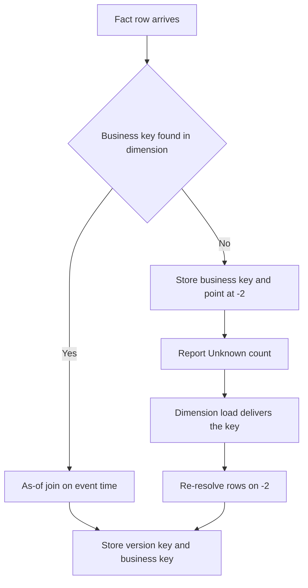
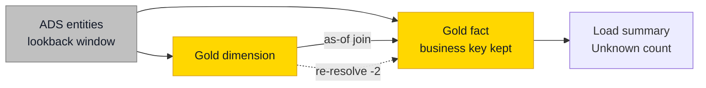

# Late-Arriving Dimensions and Facts

## Overview

Data does not arrive in the order things happened. An invoice from March lands in May. A sale references a customer the CRM hasn't sent yet. A region change gets entered three weeks after it took effect. Each case has its own handling, and all three are normal on any platform that runs long enough.

| Case | What is late | Default handling |
| ---- | ------------ | ---------------- |
| **Late-arriving fact** | The fact: its event date lies in the past and the dimension has since moved on | Resolve the key with the as-of join on the event time |
| **Late-arriving dimension** (also called an early-arriving fact) | The dimension row: the fact references a business key the dimension doesn't know yet | Keep the business key, point at `-2` (_Unknown), re-resolve after the dimension load |
| **Backdated dimension change** | A new version whose effective date lies in the past | Split the validity range, then re-resolve the facts in that window |



!!! note "One name, two meanings"
    Teams use "late-arriving fact" for both of the first two cases. In this Playbook, as in Kimball, the name follows whichever row is late. The tip on [Star - Fact Tables](star-fact-tables.md#business-keys-natural-keys) describes what Kimball calls a late-arriving dimension.

## Practical Examples

### Late-arriving fact

An invoice dated 15 March arrives on 20 May. The customer changed segment on 1 April. The invoice belongs to the March version, and the as-of join finds it without any special handling, as long as nobody resolves facts on the current flag.

```sql
SELECT
    COALESCE(d.Customer_SK, -2) AS Customer_FK,
    f.CustomerNumber AS CustomerNumber_BK,
    f.InvoiceDateTime,
    f.InvoiceAmount
FROM ADS_Invoice AS f
LEFT JOIN D_Customer AS d
  ON  d.CustomerNumber = f.CustomerNumber
  AND f.InvoiceDateTime >= d.T_ValidFromDateTime
  AND f.InvoiceDateTime <  COALESCE(d.T_ValidToDateTime, '9999-12-31');
```

The first version of every key starts at the floor (`1900-01-01`) or the source's own creation date, so old events resolve to a real member too.

Two follow-ups are easy to forget. An incremental load needs a lookback window beyond the watermark, or this row never gets picked up at all. And any aggregate or [periodic snapshot](fact-table-types.md#periodic-snapshot) covering 15 March has to be rebuilt.

### Late-arriving dimension: the default

The fact keeps its business key and points at the Unknown member. Fact foreign keys stay `NOT NULL`, and `-1` stays reserved for _N/A. After the next dimension load, the same as-of logic runs again for the rows still on `-2`.

```sql
UPDATE f
SET f.Customer_FK = d.Customer_SK,
    f.T_ModifiedRunId = @RunId,
    f.T_ModifiedDateTime = SYSUTCDATETIME()
FROM F_Invoice AS f
JOIN D_Customer AS d
  ON  d.CustomerNumber = f.CustomerNumber_BK
  AND f.InvoiceDateTime >= d.T_ValidFromDateTime
  AND f.InvoiceDateTime <  COALESCE(d.T_ValidToDateTime, '9999-12-31')
WHERE f.Customer_FK = -2;
```

Report the number of rows on Unknown with every load. A count that keeps growing is an integration problem, and this is how you find out before the client does.

```sql
SELECT COUNT(*) AS UnknownCustomerRows
FROM F_Invoice
WHERE Customer_FK = -2;
```

### Late-arriving dimension: inferred member

When the dimension lags by days, or the fact table is hard to update, insert a placeholder instead. This is called an **inferred member**.

| Approach | What goes into the dimension | Choose it when | The price |
| -------- | ---------------------------- | -------------- | --------- |
| Unknown member and re-resolve (default) | Nothing | Dimensions load at least as often as facts | Facts sit under Unknown until the next load, and the load needs an update path |
| Inferred member | A row with the business key, attributes on `_Unknown`, an inferred flag, valid from the floor | The dimension lags by days, or facts should not be updated | The first real load must overwrite that row as Type 1 and clear the flag, without creating a new version |

### Backdated dimension change

On 10 March we learn that a customer moved to another segment on 1 February. The current version has to be split at the effective date.

| | Customer_SK | Segment | T_ValidFromDateTime | T_ValidToDateTime | T_IsCurrent |
| - | ----------- | ------- | ------------------- | ----------------- | ----------- |
| Before | 301 | Retail | 1900-01-01 00:00:00 | NULL | 1 |
| After | 301 | Retail | 1900-01-01 00:00:00 | ==2026-02-01 00:00:00== | ==0== |
| After | ==302== | ==Corporate== | ==2026-02-01 00:00:00== | NULL | 1 |

Facts between 1 February and 10 March still point at version 301. Re-resolve that window with the same as-of logic, then rerun the [Type 2 checks](slowly-changing-dimensions.md#type-2-track-history).

If you need to prove what was reported before the correction, that is a job for [bitemporal history](time-travel-and-bitemporal-history.md#when-bitemporal-is-worth-it).

## Do's & Don'ts

| Do | Don't |
| -- | ----- |
| Keep the business key on every fact row | Throw away the key you will need to re-resolve |
| Point unresolved rows at `-2` | Leave the foreign key `NULL` or drop the row |
| Re-resolve after every dimension load | Leave rows on Unknown until someone complains |
| Report the Unknown count per load | Find out from a client's total |
| Use the event time in the join | Resolve a late fact on the current flag |
| Overwrite an inferred member when the real row arrives | Create a second version for what is really the first |

## Where It Fits



## Related Topics

- [Star - Fact Tables](star-fact-tables.md) - Business keys on the fact
- [Star - Dimension Tables](star-dimension-tables.md) - Special dimension members
- [Slowly Changing Dimensions](slowly-changing-dimensions.md) - Validity ranges and the as-of join
- [Data Sources & Data Loading](data-sources-and-data-loading.md) - Incremental loads
- [Data Contracts and Quality Gates](data-contracts-and-quality-gates.md) - Where the Unknown count is checked

---

## Sources

Ralph Kimball & Margy Ross, [*The Data Warehouse Toolkit*](https://www.kimballgroup.com/data-warehouse-business-intelligence-resources/books/data-warehouse-dw-toolkit/) (3rd Edition, Wiley, 2013), and the [Kimball dimensional modeling techniques](https://www.kimballgroup.com/data-warehouse-business-intelligence-resources/kimball-techniques/dimensional-modeling-techniques/). Implementation choices come from Plainsight projects on SQL Server, Fabric and Databricks.
