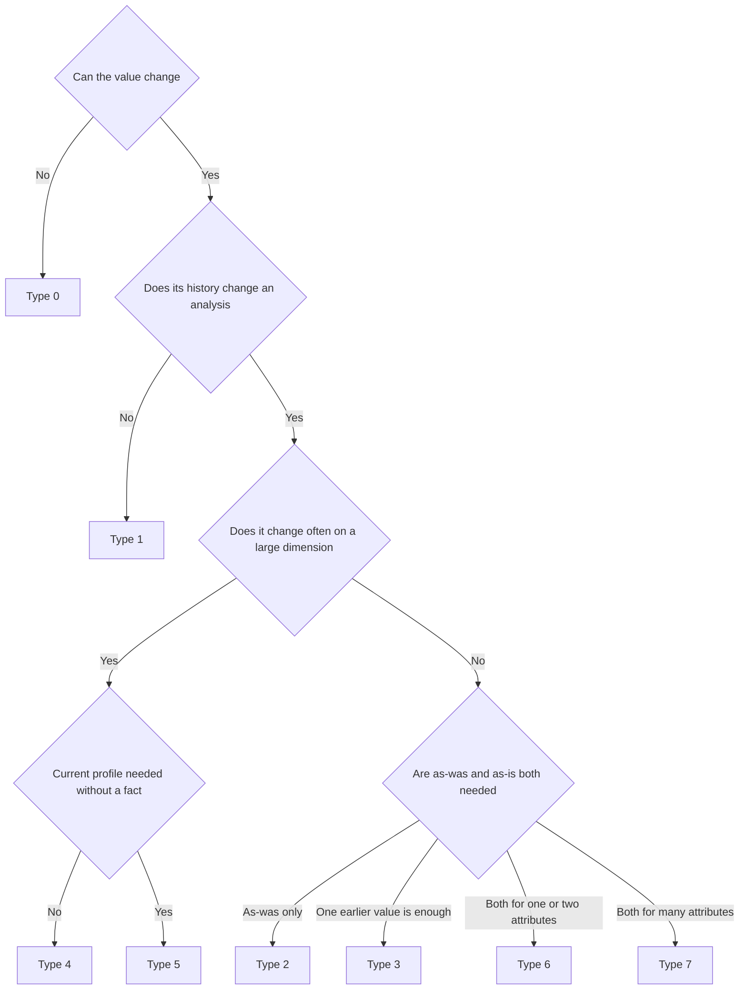
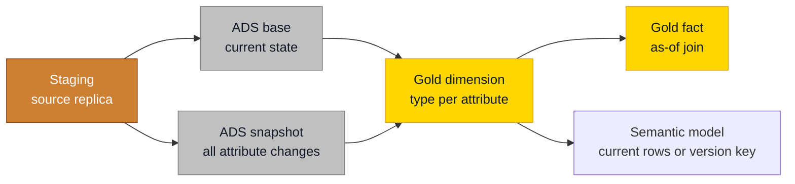

# Slowly Changing Dimensions: Types 0 to 7

## Overview

A customer moves. A product changes category. A salesperson switches region. The real question is never how to store that, it is which number last year's report should show. The SCD types are the eight possible answers, and you pick one **per attribute**, not per table.

| Type | Kimball name | What happens on a change | What a report shows | Use it for |
| ---- | ------------ | ------------------------ | ------------------- | ---------- |
| **Type 0** | Retain original | Nothing, the first value stays | The original value | Birth date, original credit score, first contract date, most date dimension attributes |
| **Type 1** | Overwrite | Update the row in place | Today's value, for all of history | Corrections, and attributes nobody analyzes over time (phone, email) |
| **Type 2** | Add new row | Close the current row, insert a new version with a new surrogate key | The value valid at the event | Region, manager, segment: anything where history changes the analysis |
| **Type 3** | Add new attribute | Copy the old value to a `Previous...` column, overwrite the main one | Today's value and one earlier value | A one-time reorganisation you want to compare before and after |
| **Type 4** | Add mini-dimension | Volatile attributes move to their own small dimension, the fact holds both keys | The profile at the event | Bands and scores that change too often for Type 2 on a large dimension |
| **Type 5** | Mini-dimension plus Type 1 outrigger | Type 4, and the base dimension also holds the current mini-dimension key | The profile at the event and today's profile | Type 4, when reports need today's profile without passing through a fact |
| **Type 6** | Add Type 1 attributes to Type 2 | Type 2, plus a `Current...` column overwritten on every version of the key | As-was and as-is, side by side on one row | One or two attributes that need both views in the same report |
| **Type 7** | Dual Type 1 and Type 2 | The fact holds the version key and the durable key, two views serve the two perspectives | As-was or as-is, chosen by view | Many attributes that need both views |



Our default is boring on purpose: **Type 1 for most attributes, Type 2 for the few whose history changes an analysis**, and Type 0 where a value must never move. Types 3 to 7 exist for specific reporting needs. Reach for them when someone can name the report.

## Practical Examples

### Write the type down per attribute

The specification of every dimension carries a line per attribute. It takes ten minutes and prevents the discussion three months later about why revenue by segment moved.

| Attribute | SCD type | Why |
| --------- | -------- | --- |
| `CustomerNumber` | Business key | Identifies the customer across versions |
| `BirthDate` | 0 | A fact of life. A wrong value is a correction, not a change |
| `Email` | 1 | Nobody reports on last year's email address |
| `Segment` | 2 | Revenue by segment must use the segment at the time of the sale |
| `PreviousSalesTerritory` | 3 | Territories were redrawn once, sales wants old and new side by side |
| `IncomeBand` | 4 | Changes often, so it lives in a mini-dimension |

A typo fix is never a new version. Correct it in place, even on a Type 2 attribute.

### Type 0: retain original

Leave the column out of the `UPDATE` list of the load, and out of the [change detection hash](hash-based-change-detection.md). That is the whole implementation.

### Type 2: track history

The mechanics are on [Star - Dimension Tables](star-dimension-tables.md#scd-type-2-track-history). Four things hold on every platform:

| Rule | What it means |
| ---- | ------------- |
| Half-open interval | Start inclusive, end exclusive. The end of one version equals the start of the next |
| Current row | `T_ValidToDateTime` is `NULL` and `T_IsCurrent` is `1`. An engine that writes its own far-future sentinel (SQL Server temporal tables) may keep it, as long as the project documents it and never mixes the two |
| First version | Starts at the floor `1900-01-01`, or at the source's own creation timestamp when you trust it. Never at load time, or every fact from before go-live lands on Unknown |
| Column names | `T_ValidFromDateTime` and friends are the default. A project documents its own convention and applies it everywhere. Names a tool writes itself (`dbt_valid_from`, `__START_AT`) stay as they are in that tool's layer and get conformed in Gold |

A fact finds the right version through one as-of join, written once per project as a macro or view:

```sql
SELECT COALESCE(d.Customer_SK, -2) AS Customer_FK
FROM ADS_Invoice AS f
LEFT JOIN D_Customer AS d
  ON  d.CustomerNumber = f.CustomerNumber
  AND f.InvoiceDateTime >= d.T_ValidFromDateTime
  AND f.InvoiceDateTime <  COALESCE(d.T_ValidToDateTime, '9999-12-31');
```

Joining on `T_IsCurrent = 1` instead is Type 1 behaviour wearing a Type 2 costume: every historical fact lands on today's version.

Run both checks after every load. Each must return zero rows.

```sql
-- Exactly one current row per business key
SELECT CustomerNumber
FROM D_Customer
GROUP BY CustomerNumber
HAVING SUM(CASE WHEN T_IsCurrent = 1 THEN 1 ELSE 0 END) <> 1;

-- No overlapping validity ranges
SELECT a.Customer_SK, b.Customer_SK
FROM D_Customer AS a
JOIN D_Customer AS b
  ON  a.CustomerNumber = b.CustomerNumber
  AND a.Customer_SK < b.Customer_SK
  AND a.T_ValidFromDateTime < COALESCE(b.T_ValidToDateTime, '9999-12-31')
  AND b.T_ValidFromDateTime < COALESCE(a.T_ValidToDateTime, '9999-12-31');
```

### Type 3: add new attribute

Sales territories are redrawn on 1 January. Management wants this year's numbers under both maps for one year. Kimball calls this an alternate reality.

| Customer_SK | CustomerName | SalesTerritory | PreviousSalesTerritory |
| ----------- | ------------ | -------------- | ---------------------- |
| 2001 | Customer A | ==North-East== | ==East== |

Type 3 keeps exactly one earlier value. A second reorganisation pushes the first one out. If people start asking for the one before that, you wanted Type 2.

### Type 4: add mini-dimension

Age band, income band and purchase frequency change constantly. On a dimension of ten million customers, Type 2 would create a new version per customer several times a year. Split them off.

```sql
CREATE TABLE D_CustomerProfile
(
    CustomerProfile_SK BIGINT NOT NULL,
    AgeBand VARCHAR(20) NOT NULL,
    IncomeBand VARCHAR(20) NOT NULL,
    PurchaseFrequencyBand VARCHAR(20) NOT NULL
);

-- The fact records both keys at the moment of the event
-- Customer_FK        BIGINT NOT NULL
-- CustomerProfile_FK BIGINT NOT NULL
```

The mini-dimension holds one row per combination of bands, so it stays small.

!!! warning "Type 4 means two things"
    Outside Kimball, "Type 4" often means a separate history table next to a current table, which is what SQL Server temporal tables give you. In our layered architecture that job belongs to the [ADS snapshot](analytical-data-store-ads.md#snapshot-tables-historical-tracking). When a client says Type 4, ask which one they mean.

### Type 5: mini-dimension plus Type 1 outrigger

Type 4 tells you the profile at the event, but only through a fact. Type 5 adds `CurrentCustomerProfile_FK` to the base dimension and overwrites it whenever the current band combination changes. Present the base dimension and the outrigger as one table to report users, so nobody has to know the outrigger exists.

### Type 6: add Type 1 attributes to Type 2

The Type 2 column keeps the value at the event. A `Current...` column is overwritten on **every** version of the key.

| Product_SK | ProductCode | Category | CurrentCategory | T_ValidFromDateTime | T_ValidToDateTime | T_IsCurrent |
| ---------- | ----------- | -------- | --------------- | ------------------- | ----------------- | ----------- |
| 501 | AB-1 | Strategy | ==Education== | 1900-01-01 00:00:00 | 2026-03-01 00:00:00 | 0 |
| 502 | AB-1 | Education | Education | 2026-03-01 00:00:00 | NULL | 1 |

A fact on version 501 can be grouped under the category at the time of sale (`Category`) or today's category (`CurrentCategory`). The price is one extra `UPDATE` across all versions of the changed key, on every load.

### Type 7: dual Type 1 and Type 2

The fact stores the version key and a **durable key**, the identifier that stays the same across all versions of the entity. The durable key is usually a `BIGINT` assigned per business key, because no text key reaches a relationship. A single dimension table then serves both perspectives.

```sql
-- As-was: the fact joins on Customer_FK, every version visible
CREATE VIEW D_Customer_AsWas AS
SELECT * FROM D_Customer;

-- As-is: the fact joins on Customer_DK, current rows only
CREATE VIEW D_Customer_AsIs AS
SELECT * FROM D_Customer WHERE T_IsCurrent = 1;
```

## Do's & Don'ts

| Do | Don't |
| -- | ----- |
| Decide the type per attribute and write it in the specification | Apply one type to a whole dimension because it is quicker |
| Give Type 2 only to attributes a report needs the history of | Version everything "just in case": the ADS snapshot already keeps the full history |
| Resolve facts with one shared as-of join | Join a Type 2 dimension on the current flag |
| Test one current row per key and no overlaps after every load | Assume the load is right because it finished |
| Expose current rows to the semantic model unless history reporting is an explicit requirement | Use the validity end as a relationship column in Power BI |
| Relate on the version key resolved at load time when history is required | Recalculate the version in DAX |

## Where It Fits

ADS snapshots keep the full history of an entity. Gold dimensions then choose, attribute by attribute, how much of that history a report gets to see.



## Related Topics

- [Star - Dimension Tables](star-dimension-tables.md) - Dimension structure and the Type 1 and Type 2 mechanics
- [Analytical Data Store (ADS)](analytical-data-store-ads.md) - Where the full attribute history is kept
- [Hash-Based Change Detection](hash-based-change-detection.md) - How a load notices that an attribute changed
- [Late-Arriving Dimensions and Facts](late-arriving-dimensions-and-facts.md) - What to do when history shows up out of order
- [Time Travel and Bitemporal History](time-travel-and-bitemporal-history.md) - Modelled history versus storage history

---

## Sources

Ralph Kimball & Margy Ross, [*The Data Warehouse Toolkit*](https://www.kimballgroup.com/data-warehouse-business-intelligence-resources/books/data-warehouse-dw-toolkit/) (3rd Edition, Wiley, 2013), and the [Kimball dimensional modeling techniques](https://www.kimballgroup.com/data-warehouse-business-intelligence-resources/kimball-techniques/dimensional-modeling-techniques/). Implementation choices come from Plainsight projects on SQL Server, Fabric and Databricks.
