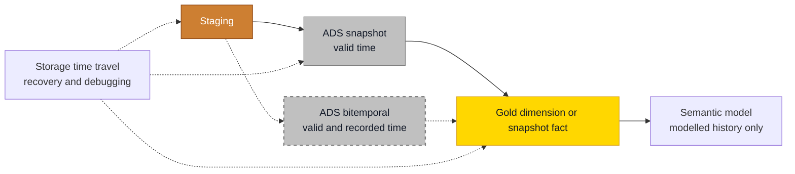

# Time Travel and Bitemporal History

## Overview

"What did this look like back then?" sounds like one question. It is at least three, and they need different tools. Start with the two clocks every record lives on.

| | Valid time | Transaction time |
| - | ---------- | ---------------- |
| **Also called** | Business time, effective time | System time, recorded time |
| **Question it answers** | When was this true in the real world? | When did the platform know about it? |
| **Who sets it** | The source or the business, and it can be backdated | The platform at write time, and it never moves |
| **Modelled with** | SCD Type 2 ranges, periodic snapshots | An append-only record, a system-versioned table |

Now match the question to the tool.

| Question | Tool | Why |
| -------- | ---- | --- |
| Revenue by the region the salesperson was in at the sale | **As-of join** on a [Type 2 dimension](slowly-changing-dimensions.md#type-2-track-history) | Valid time, kept for as long as the table exists |
| Stock level at the end of last month | [Periodic snapshot](fact-table-types.md#periodic-snapshot) | Valid time, built to be queried |
| A load went wrong an hour ago, get the table back | **Storage time travel** | Recovery, inside the retention window |
| What changed in this table between two runs | Storage time travel | Debugging, inside the retention window |
| What did we report at quarter close, before the restatement | Frozen snapshot per close, or **bitemporal** history | Needs transaction time on purpose |

## Practical Examples

### Storage time travel is not history

Storage time travel is excellent at what it is for. It reads an older version of the files, within limits that are set by retention, not by your reporting needs.

| Engine | Syntax | Limit |
| ------ | ------ | ----- |
| Delta on Databricks or Fabric Lakehouse | `SELECT * FROM t VERSION AS OF 123` or `TIMESTAMP AS OF '2026-03-13'` | Needs both the log (`delta.logRetentionDuration`, 30 days by default) and the data files (`delta.deletedFileRetentionDuration`, 7 days by default, removed by `VACUUM`) |
| Fabric Warehouse | `OPTION (FOR TIMESTAMP AS OF '2026-03-13T19:39:35.28')` | 30 calendar days by default, configurable from 1 to 120. UTC only. Dropping and recreating a table removes its history |
| SQL Server temporal tables | `FOR SYSTEM_TIME AS OF '2026-03-13'` | Transaction time only, for as long as the history table is retained |

Check the current limits for your runtime before you promise anything. Databricks says it plainly in its [table history documentation](https://docs.databricks.com/aws/en/delta/history): do not use table history as a long-term backup. [Fabric Warehouse time travel](https://learn.microsoft.com/fabric/data-warehouse/time-travel) has its own list of limitations.

The retention window is the smaller problem. Storage time travel moves along **load time**, so a version from 3 March shows what had been loaded by 3 March, not what was true on 3 March. A full refresh makes that worse: the old version then reflects the rebuild.

So nothing a consumer depends on contains a `VERSION AS OF` or a `FOR TIMESTAMP AS OF`. If a report needs the past, model the past.

### As-of join versus time travel

```sql
-- As-of join: the customer's segment at the moment of each invoice, for all years
SELECT d.Segment, SUM(f.InvoiceAmount) AS InvoiceAmount
FROM ADS_Invoice AS f
JOIN D_Customer AS d
  ON  d.CustomerNumber = f.CustomerNumber
  AND f.InvoiceDateTime >= d.T_ValidFromDateTime
  AND f.InvoiceDateTime <  COALESCE(d.T_ValidToDateTime, '9999-12-31')
GROUP BY d.Segment;

-- Time travel on Delta: the table as it was loaded yesterday, for debugging
SELECT COUNT(*) FROM gold.d_customer TIMESTAMP AS OF '2026-03-13';
```

### When bitemporal is worth it

Bitemporal means tracking both clocks on the same record. It costs a second interval, harder queries and more explaining, so make it an explicit, documented decision. It earns its keep when restatements have to be auditable: regulated reporting, insurance, financial close, anything where someone can ask why the number changed and who knew what, when.

If the only requirement is "show what we published at quarter close", a frozen periodic snapshot per close is cheaper and easier to explain.

### A restatement, step by step

On 10 April we learn that a premium changed on 1 March. Nothing gets overwritten. The row we believed until now is closed in transaction time, and the corrected picture is added.

| PolicyNumber | Premium | T_ValidFromDateTime | T_ValidToDateTime | T_RecordedFromDateTime | T_RecordedToDateTime |
| ------------ | ------- | ------------------- | ----------------- | ---------------------- | -------------------- |
| P-1 | 100 | 1900-01-01 | NULL | 2026-01-15 | ==2026-04-10== |
| P-1 | 100 | 1900-01-01 | ==2026-03-01== | ==2026-04-10== | NULL |
| P-1 | ==120== | ==2026-03-01== | NULL | ==2026-04-10== | NULL |

Now one record answers both questions. What did we believe on 31 March about the premium on 15 March? 100.

```sql
DECLARE @ValidAt DATETIME2 = '2026-03-15';
DECLARE @KnownAt DATETIME2 = '2026-03-31';

SELECT Premium
FROM ADS_Policy_Bitemporal
WHERE PolicyNumber = 'P-1'
  AND @ValidAt >= T_ValidFromDateTime
  AND @ValidAt <  COALESCE(T_ValidToDateTime, '9999-12-31')
  AND @KnownAt >= T_RecordedFromDateTime
  AND @KnownAt <  COALESCE(T_RecordedToDateTime, '9999-12-31');
```

Run the same query with `@KnownAt = '2026-04-30'` and the answer is 120.

## Do's & Don'ts

| Do | Don't |
| -- | ----- |
| Model every point-in-time question that a report asks | Point a report at `VERSION AS OF` or `FOR TIMESTAMP AS OF` |
| Use time travel to recover from a bad load and to debug | Treat retention settings as your archive |
| Keep valid time and load time in separate columns | Fill a business validity date with the load timestamp |
| Decide on bitemporal explicitly and write the reason down | Add a second interval to every table because it might be useful |
| Keep bitemporal records in ADS and offer Gold one perspective | Make every report author reason about two clocks |

## Where It Fits



## Related Topics

- [Slowly Changing Dimensions](slowly-changing-dimensions.md) - Valid time in a dimension
- [Fact Table Types](fact-table-types.md) - Periodic snapshots
- [Analytical Data Store (ADS)](analytical-data-store-ads.md) - Where history is built up
- [Late-Arriving Dimensions and Facts](late-arriving-dimensions-and-facts.md) - Backdated changes in practice
- [Data Sources & Data Loading](data-sources-and-data-loading.md) - How rows reach the platform

---

## Sources

Ralph Kimball & Margy Ross, [*The Data Warehouse Toolkit*](https://www.kimballgroup.com/data-warehouse-business-intelligence-resources/books/data-warehouse-dw-toolkit/) (3rd Edition, Wiley, 2013). Engine behaviour from [Databricks table history](https://docs.databricks.com/aws/en/delta/history), [Fabric Warehouse time travel](https://learn.microsoft.com/fabric/data-warehouse/time-travel) and [SQL Server temporal tables](https://learn.microsoft.com/sql/relational-databases/tables/temporal-tables).
