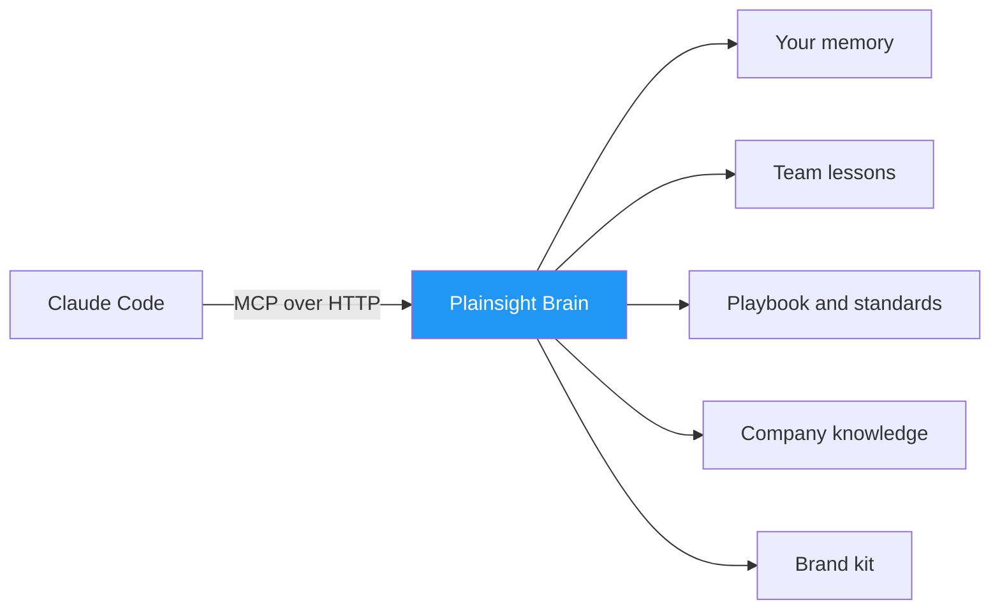
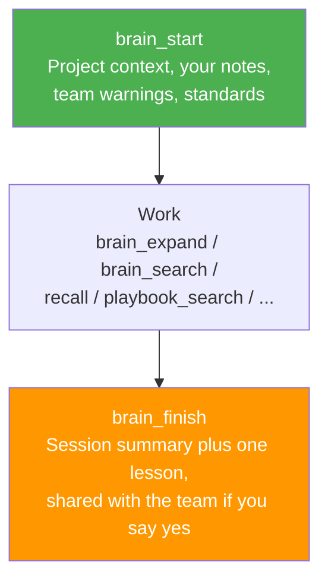

# Connect Plainsight Brain to Claude Code

??? info "Purpose"
    Plainsight Brain is our team's shared memory: an MCP server that gives Claude Code your personal memory, the team's lessons, project context, the playbook, our engineering standards, the brand kit and company knowledge. This guide connects Claude Code to it so every session starts with context and ends with a lesson for the next person.

!!! tip "New to the Brain?"
    Start with [🧠 AI-Native, In Plain Sight](../../../about-plainsight/ai-native.md): why we built the Brain, what it already does, how the relationship map works, My Brain, and setup for other tools (our AI Assistant, Codex, Cursor, Copilot). This page covers the Claude Code setup in detail.

## How It Works



Claude Code connects to the Brain over MCP. Authentication uses your `@plainsight.pro` Entra ID: the server advertises its sign-in endpoints, so Claude Code handles the login for you.

## Prerequisites

| Requirement | Details |
|-------------|---------|
| **Claude Code** | CLI installed (`npm install -g @anthropic-ai/claude-code`) |
| **Plainsight Entra ID** | Your `@plainsight.pro` account |
| **Brain access** | Your account must be allowed to use the Brain app registration. Ask an admin if you get a login loop. |

## Step 1: Add the Brain

For every project on your machine (recommended), run this once:

```bash
claude mcp add --transport http --scope user plainsight-brain https://barabas.plainsight.pro/mcp
```

That's it: no tokens, no secrets, no local server to run.

??? tip "Only for one repository, shared with your team"
    Use `--scope project` instead. Claude Code then writes a `.mcp.json` in the repo root, which you can commit so everyone on the project gets the Brain:

    ```json
    {
      "mcpServers": {
        "plainsight-brain": {
          "type": "http",
          "url": "https://barabas.plainsight.pro/mcp"
        }
      }
    }
    ```

    Already connected at user scope? Then you don't need this as well.

## Step 2: Authenticate

1. Start Claude Code and type `/mcp`
2. Select `plainsight-brain` and choose to authenticate; your browser opens
3. Sign in with your `@plainsight.pro` account
4. Approve the consent prompt (first time only)
5. Tokens are stored for you, so later sessions reconnect without asking

Run `/mcp` again to check: `plainsight-brain` should show as connected.

## Step 3: Follow the Agent Lifecycle

Every meaningful session has three moments. They make sure Claude gets context at the start and the team gets a lesson at the end.



**Start every task** by telling Claude what you're working on. It calls `brain_start`, which returns project context, past findings and the prevention cards the team already paid for.

**End every task** by letting Claude call `brain_finish`. It stores a short summary and the lesson worth keeping. If a warning from the briefing actually changed what you did, let Claude pass its id in `applied_finding_ids`: that's the signal that keeps a useful lesson alive.

!!! warning "Without `brain_finish`, your session is invisible to the team"
    The work still happens if you skip the finish. The team just doesn't learn anything from it.

## Make It Stick in Your Repo

Agents follow what's written down. Put the habit in the repo's `CLAUDE.md`, and the same lines in an `AGENTS.md` for colleagues who use Codex, Copilot or Cursor:

```markdown
## Plainsight Brain
- Start every task with brain_start(project="<repo-name>", task="<what you are doing>").
- End every task with brain_finish, including one durable lesson.
- If the plainsight-brain tools are missing, stop and ask. Don't guess.
```

Keep secrets and infrastructure IDs out of these files: they get committed.

## What You Get

The exact set of tools depends on your role and on which features are switched on. These are the ones you'll use most:

| Category | Examples | What it does |
|----------|----------|--------------|
| **Session lifecycle** | `brain_start`, `brain_expand`, `brain_finish` | Start with context, pull more detail on demand, end with a lesson |
| **Search everything** | `brain_search` | One question across lessons, your memory, projects, plans, files and the company knowledge graph |
| **Memory** | `remember`, `recall`, `correct_memory`, `archive_memory` | Your private memory. Corrections keep the old version in the history |
| **Team lessons** | `team_search_findings`, `team_share_finding` | What colleagues learned and chose to share |
| **Company knowledge** | `brain_search`, `search_knowledge_base`, `my_knowledge_access` | The relationship map plus our documents, filtered to what you may see |
| **Projects and plans** | `sync_project`, `get_project_brief`, `save_plan` | Project context and plans that survive a context reset |
| **Shared projects** | `prepare_project_share`, `commit_project_share` | Hand a project to a colleague, previewed before it's shared |
| **Playbook and standards** | `playbook_search`, `sdlc_search_guidance`, `sdlc_check_conformance` | How we do things here, delivered while you work |
| **Brand** | `brand_get_kit`, `brand_check` | The complete brand kit, then a line-by-line check of what you made |
| **Audits** | `store_audit`, `start_reaudit`, `compare_audits` | Record review findings and compare each re-audit with the last one |

!!! info "Admin-only for now"
    Automated repository review and the secret vault are visible to Brain admins only. For everyone else these tools don't appear at all, which is on purpose.

To see what the Brain keeps for you, open [My Brain](https://barabas.plainsight.pro/my-brain).

## Combining with Other MCP Servers

The Brain works alongside other MCP servers. In a project `.mcp.json`, add them as siblings under `mcpServers`:

```json
{
  "mcpServers": {
    "plainsight-brain": {
      "type": "http",
      "url": "https://barabas.plainsight.pro/mcp"
    },
    "databricks": {
      "command": "uv",
      "args": ["run", "--directory", "/path/to/ai-dev-kit", "python", "databricks-mcp-server/run_server.py"],
      "env": { "DATABRICKS_CONFIG_PROFILE": "my-workspace" },
      "defer_loading": true
    }
  }
}
```

Each server is an independent connection. The Brain uses Entra sign-in in your browser, while Databricks uses a local CLI profile, so they don't interfere with each other. See [Connect Databricks MCP to Claude Code](../../databricks/databricks-mcp-claude-code.md).

## Who You Are to the Brain

The Brain reads who you are from your sign-in. Almost everyone is in the first row.

| Tier | Who | Access |
|------|-----|--------|
| **Personal** (default) | Any Plainsight sign-in | Your memory, projects, plans and history, plus all shared team knowledge. Secrets only if you're an admin. |
| **Team** | A shared automation token | Shared knowledge only. **No** personal memory. **No** secrets. |
| **Workspace** | A workspace token | One collaboration space. Nothing else. |

## Troubleshooting

| Symptom | Fix |
|---------|-----|
| Sign-in loop or it never completes | Your Entra account may not have access to the Brain app registration. Ask an admin to add you. |
| `plainsight-brain` shows as disconnected in `/mcp` | Run `/mcp`, select the server and reconnect. The token may have expired. |
| 401 Unauthorized on Brain tools | Same: reconnect through `/mcp`. |
| Tools appear but calls fail | Check `/mcp` for details. A common cause is Entra consent not yet granted for your account. |
| Not sure if it's you or the service | Open [barabas.plainsight.pro/readyz](https://barabas.plainsight.pro/readyz). It needs no login and reports whether the Brain and its stores are reachable. |
| Server returns 503 | The server is starting up. Wait about 30 seconds and retry. |
| Still connected to an old address | If your config points at a `*.azurecontainerapps.io` URL, replace it with `https://barabas.plainsight.pro/mcp` and sign in again. |

## Related

- [🧠 AI-Native, In Plain Sight](../../../about-plainsight/ai-native.md): the why, My Brain, the relationship map, and setup for other tools
- [🧠 Claude Code Extensibility](skills.md): CLAUDE.md, skills, agents, hooks and MCP servers
